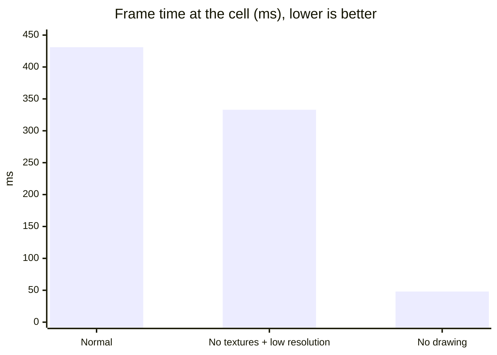

<div align="center">


<a href="#where-the-game-stands"></a>

<p>
  <a href="README.md"></a>
  <a href="README.en.md"></a>
  <a href="../../releases/latest"></a>
</p>

<p>
  
  
  
  
  
  
</p>

<p>
  <a href="#run-it"></a>
  <a href="#the-launcher"></a>
  <a href="#speed"></a>
  <a href="#picture"></a>
  <a href="#what-is-left"></a>
</p>

</div>

A working version of [VIctory](https://github.com/Marvisak/VIctory), which runs
the Xbox Series build of an open-world game natively on Windows from game
files you supply yourself. It starts from
[fxceless/victory-fork](https://github.com/fxceless/victory-fork) (up to
`4e17478`), with the view map of [Xeltax/VIcky](https://github.com/Xeltax/VIcky)
and work from many other forks (credited in the commits). The French
[README](README.md) has every measurement in full; this page is the summary.

> [!IMPORTANT]
> **This repository contains no game files**: no executable, data or extracted
> shaders. You need your own copy of the game. Not affiliated with or endorsed
> by the game's developer or publisher.

## Where the game stands

**About 59 % on [PortWatch VI](https://portwatch-vi.xyz/#method)'s scale:
playable** (you control the heroine in the prologue).

| Step | State |
|---|---|
| Boot, menus, title screen | ✅ works, 30 fps |
| Intro cutscene | ✅ plays through and displays correctly |
| Saves | ✅ the game saves and reloads a checkpoint |
| Prologue | ✅ playable: characters, textures, sky, sunlit exterior |
| Light in the shade | ⚠️ fallback light by default (the game's ray tracing does not run yet) |
| Frame rate in the world | ❌ 2.3 fps (431 ms a frame) on an RTX 3060 with 16 GB of RAM |
| Memory | ❌ about 21 GB committed on a 16 GB PC (Windows pages to disk) |
| Stability | ⚠️ 10 minutes without a crash in the longest measured run |

## Run it

**Easiest:** download the package from the
[latest release](../../releases/latest), unzip it, put your game folder in
`victory.toml` (`[paths] game_dir = '...'`), run `Prechauffer.cmd` once
(it translates every shader into the cache, a few minutes), then
`Lanceur.exe`.

**From source:**

```powershell
cargo build --profile diag -p victory --features diagnostics
target\diag\victory.exe translate --cache
target\diag\victory.exe run "<game folder>\<the game's exe>" --execute --console series-s
```

Requirements: Windows 10/11 x64 with AVX2, a D3D12 GPU with shader model 6.6
and mesh shaders (NVIDIA RTX 20 series or newer), 16 GB of RAM or more and a
**page file of at least 32 GB**, the Microsoft Visual C++ x64 redistributable.

### The launcher

`Lanceur.exe` (source in `apps/lanceur`, Rust + egui), in French:

- **ready-made modes** and **manual settings**: Series S or X, internal
  resolution (0.2 to 1.0), the game's own temporal upscaler, textures,
  lighting, on-screen counter, AMD FSR (experimental), extra `VICTORY_…`
  variables;
- **live fps** while playing (ms a frame, draws, world or menus, play time,
  last log lines); the full log goes to `logs\partie-lanceur-<date>.txt`;
- **Discord presence**: "Playing" and the game's name, from the entry Discord
  already has in its public list of games (nothing to create), with where you
  are, the fps, the mode and the elapsed time;
- **saves by place**: keep the current state under a name (cell, cafeteria,
  boat...) and start from it next time.

Build it with `cd apps\lanceur` then `cargo build --release`.

### Test modes

| Switch | Effect |
|---|---|
| `VICTORY_NO_TEXTURES=1` | the game's textures are neither sent to the GPU nor shown: every view reads a small grey texture of the same shape |
| `VICTORY_NO_DRAWS=1` | no pipelines, no shaders: every draw is dropped, the screen stays black (the counter shows); the game still runs, to measure the game alone |

## Speed



| Per frame | Normal | No textures, low resolution | No drawing |
|---|---|---|---|
| fps | 2.3 | **3.0** (steady) | **19 to 24** |
| Our copies of game memory | 135 ms | 130 ms (180 MB a frame) | 0.4 ms |
| GPU | 207 ms | 112 ms | 0 |
| Copy-back into game memory | 50 ms | 34 ms | 0.1 ms |
| Game RAM (committed) | 21 GB | 14.4 GB | **6 GB** |

What this says:

1. **This PC tops out around 20 fps**: with nothing drawn, the game's own
   code (world, characters, streaming, sound) and our system services take
   42 to 53 ms a frame.
2. **The 15 GB that overflow the RAM are our graphics layer's**, not the
   game's (6 GB without drawing, 21 GB with).
3. **Hypothesis**: textures and resolution are no longer the problem. What
   is left does not depend on pixels: our copies of about 180 MB of game
   memory to the GPU every frame (130 ms, the biggest wall), our work around
   each indirect draw (about 2,000 clamp passes, each with a pipeline drain,
   about 110 ms), and a full RAM (1 GB free). The next real gain is to keep
   the game's data on the GPU instead of copying it every frame.

Tried on 25 November and dropped: grouped indirect clamps (GPU 207 → 239 ms,
a fence vanished), translated shaders noting missing pages in a branch
(1.9 fps), card copies turned off (CPU work 490 ms), ScarlettPort's runtime
as-is (black intro, under 1 fps here), upstream's page-marked copy-back
(about 100 conflicts on this branch).

### Other forks

| Fork | GPU | fps | Of use here |
|---|---|---|---|
| This one (25/11) | RTX 3060, 16 GB | **2.3** (measured) | — |
| [ScarlettPort](https://github.com/ZigZagBoi1/ScarlettPort) | RTX 3060, 32 GB advised | about 4 | copy-back for read-back buffers only; tried here: under 1 fps |
| [VItoriaBr](https://github.com/uiliannn/VItoriaBr) | RTX 5060 Ti, 40 GB | 3.5 to 6 | their GPU takes 50 to 65 ms a frame |
| [DexNom/VIctory](https://github.com/DexNom/VIctory) | RX 7900 XTX | 1.03 | ray tracing that really runs (Radeon) |
| [ztrx](https://github.com/Zettrox/ztrx) | RTX 3050 | 1 to 3 | prologue to the boat chase, 1 h 30 without a crash |

## Picture

- **Shaders**: 99.89 % of the game's 25,694 programs translate.
- **Upscaling**: as a Series S the game renders 1280×720 and asks FSR 4 for
  1920×1080; FSR 4 cannot run here, so a plain stretch stands in. An
  experimental port of upstream's module serves the game's calls with AMD's
  PC FSR 3.1 (`VICTORY_FIDELITYFX_DIR`, the official DLL from the FidelityFX
  SDK); it lost the GPU in its second test, so do not use it to play.
- **Ray tracing**: the builder and trace programs translate and the hardware
  ray test is emulated, but nothing is lit by ray tracing yet; a fallback
  light brightens shaded areas.

## What is left

1. Speed: keep the game's data on the GPU instead of copying it every frame;
   cheaper indirect draws; this PC tops out around 20 fps.
2. Memory: under 16 GB, so Windows stops paging.
3. Ray tracing in the game (DexNom's Radeon work is the lead).
4. Stability over a long session.

## Credits and license

[VIctory](https://github.com/Marvisak/VIctory) by Marvisak and contributors is
the base of everything (GPL-3.0-or-later, like this repository, see
`LICENSE`); [victory-fork](https://github.com/fxceless/victory-fork) by
fxceless; [VIcky](https://github.com/Xeltax/VIcky) by Xeltax; and the many
forks whose commits are taken here, named in each commit. Developed with
[Claude Code](https://claude.com/claude-code).
