<div align="center">


<a href="#où-en-est-le-jeu"></a>

<p>
  <a href="README.md"></a>
  <a href="README.fr.md"></a>
  <a href="https://discord.gg/GBJT5E8E4E"></a>
  <a href="../../releases/latest"></a>
</p>

<p>
  
  
  
  
  
  
</p>

<p>
  <a href="#lancer"></a>
  <a href="#le-lanceur-lanceurexe"></a>
  <a href="#vitesse"></a>
  <a href="#mémoire"></a>
  <a href="#image"></a>
  <a href="#ce-qui-reste-à-faire"></a>
</p>

</div>

Version de travail de [VIctory](https://github.com/Marvisak/VIctory), qui fait
tourner la version Xbox Series d'un jeu en monde ouvert directement sous Windows,
à partir des fichiers du jeu que l'utilisateur fournit. Elle part du fork
[fxceless/victory-fork](https://github.com/fxceless/victory-fork) (commit
`578d459`) et de ses commits suivants, jusqu'à `4e17478`, plus la « carte des
vues » de [Xeltax/VIcky](https://github.com/Xeltax/VIcky) (branche
`fx-heapmap`).

> [!NOTE]
> **Nouveau le 25/11 au soir** : un [lanceur](#le-lanceur-lanceurexe) avec
> présence Discord et sauvegardes par endroit, deux [modes de test](#modes-de-test)
> (sans textures, sans dessin), et la mesure de [ce que coûte le jeu
> seul](#le-2511-au-soir--ce-que-coûte-le-jeu-seul-et-ce-que-coûte-notre-couche).

> [!IMPORTANT]
> **Ce dépôt ne contient aucun fichier du jeu** : ni exécutable, ni données, ni
> shaders extraits. Il faut sa propre copie du jeu. Ce projet n'est ni affilié à
> son développeur ni son éditeur, ni approuvé par eux.

Mis à jour le 25/11/2026 au soir (lanceur, modes de test, mesures du jeu
seul, FSR expérimental).

## Communauté

Questions, résultats sur ton PC, bugs : le **[serveur Discord](https://discord.gg/GBJT5E8E4E)**.
Pour un bug, joins le fichier `logs\partie-lanceur-<date>.txt` et, s'il y en a
un, `%LOCALAPPDATA%\victory\data\7952987A\crashes.log`.

## Crédits et licence

- **[VIctory](https://github.com/Marvisak/VIctory)**, par Marvisak et ses
  contributeurs, est la base de tout : le chargeur, les services du système,
  le rendu Direct3D 12 et le recompilateur de shaders. Licence
  GPL-3.0-or-later, comme ce dépôt (voir `LICENSE`).
- **[victory-fork](https://github.com/fxceless/victory-fork)**, par fxceless :
  le fork dont part ce travail (rendu du monde, ray tracing en cours).
- **[VIcky](https://github.com/Xeltax/VIcky)**, par Xeltax : la carte des vues
  pour la limite d'un million de vues des cartes NVIDIA.
- **[XCL](https://github.com/ivall/xcl)**, par ivall (GPL-2.0-only), a servi de
  référence pour le comportement du jeu sous une autre couche.
- Le texte d'origine, en anglais, est dans
  [docs/README-original.en.md](docs/README-original.en.md).
- Développé avec [Claude Code](https://claude.com/claude-code).

## Où en est le jeu

### Avancement du portage : environ 60 %

`████████████░░░░░░░░` **environ 60 % : jouable** (on dirige l'héroïne dans le prologue)

Mesuré avec le barème de [PortWatch VI](https://portwatch-vi.xyz/#method) :
jusqu'à 50 %, chaque étape demande la précédente ; au-delà, l'histoire, le
rendu, la vitesse et la stabilité se partagent les 50 derniers points. Ces
points-là sont notre estimation : PortWatch ne les compte qu'avec une
preuve (une vidéo).

| Palier | % | État |
|--------|---|------|
| Fondations (chargeur, bibliothèques, shaders, rendu D3D12) | 0-10 | ✅ |
| L'exécutable tourne | 10 | ✅ |
| Première image (logos, intro) | 20 | ✅ |
| Menu principal | 30 | ✅ |
| Dans le monde (le prologue se charge et s'affiche) | 40 | ✅ |
| Jouable (on dirige un personnage) | 50 | ✅ l'héroïne bouge dans le prologue |
| Histoire (17,5 points) | 0 | ⏳ encore dans l'ouverture ; finir le prologue en rapporte environ 3 |
| Rendu (12,5 points) | environ 6 | ⚠️ éclairé, mais de gros effets manquent (ombre, ray tracing) |
| Vitesse (10 points : images/s ÷ 30) | environ 1,4 | ❌ 4,0 à 4,4 images/s (partie de 10 minutes, nuit du 25/11) ; objectif 15 |
| Stabilité (10 points) | environ 2,5 | ⚠️ pas encore mesurée sur une longue partie |

### Détail

| Étape | État |
|-------|------|
| Démarrage, menus, écran titre | ✅ fonctionne |
| Cinématique d'intro | ✅ se joue en entier et s'affiche correctement (vérifié en jeu le 25/11) |
| Sauvegardes | ✅ le jeu sauvegarde et recharge un point de passage |
| Premier passage jouable (prologue) | ✅ on dirige l'héroïne ; s'affiche : personnages, textures, ciel, extérieur au soleil |
| Lumière dans l'ombre | ⚠️ lumière de secours par défaut : intérieurs et visages éclairés, mais certaines cinématiques restent presque noires (le ray tracing du jeu ne tourne pas encore). Les essais 8 et 9 étaient plus sombres à cause d'un blocage des textures quand la mémoire était basse, retiré le 25/11 (commit `3b5bcb6`) |
| Images par seconde dans le monde | ❌ 4,0 à 4,4 (230 à 250 ms par image : préparation 125, carte 85-100, recopie 55-70) sur RTX 3060 et 16 Go de RAM ; 30 dans les menus |
| Mémoire | ⚠️ 22 à 25 Go réservés sur un PC de 16 Go. Le côté processeur des copies qui vivent sur la carte est maintenant de la mémoire ordinaire que Windows peut mettre sur le disque (avant : 3 à 4,5 Go bloqués pour la carte) : à la fin d'une partie de 10 minutes, le jeu garde environ 5 Go en RAM au lieu de moins de 1 Go |
| Stabilité | ⚠️ une partie complète de 10 minutes dans le monde sans arrêt (25/11 au soir), là où le jeu s'arrêtait net vers 9 minutes. `VICTORY_HOLD=71B6330:1` met en pause le chien de garde du jeu et `VICTORY_PATCH=5AD8E60:E8DB605FFF:B800000100,5ABB240:E8FB3C61FF:B800000100` agrandit deux réserves d'objets qui se vidaient (idées de Tejvardhan-717) ; un fichier d'échange de 32 Go au moins aide encore. Un débordement de pile est rapporté au lieu de fermer la fenêtre en silence |

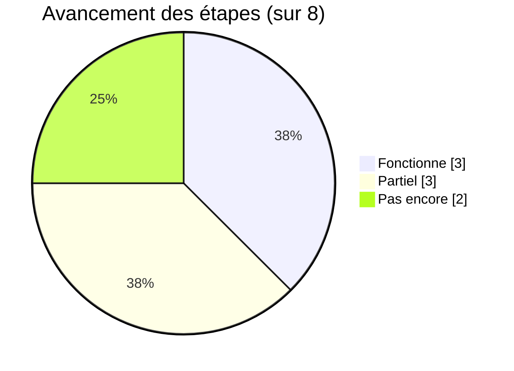

## Lancer

**Le plus simple** : télécharger le paquet de la
[dernière version](../../releases/latest), le décompresser, mettre le dossier
du jeu dans `victory.toml` (`[paths] game_dir = '...'`), lancer
`Prechauffer.cmd` une fois (quelques minutes), puis `Lanceur.exe`. Il faut une
carte RTX 20 ou plus récente, 16 Go de RAM ou plus, un fichier d'échange de
32 Go et le « Visual C++ Redistributable » x64 de Microsoft.

**Depuis les sources** :

```powershell
cargo build --profile diag -p victory --features diagnostics
target\diag\victory.exe run "D:\chemin\vers\game_scarlett_master.exe" --execute
```

Le chemin du jeu peut aussi être mis dans `victory.toml` (modèle :
`victory.example.toml`).

### Le lanceur (`Lanceur.exe`)

Une fenêtre en Rust (`apps/lanceur`) pour jouer sans PowerShell :

- **modes tout prêts** (ceux de `Lancer.cmd`, plus deux modes de test) et
  **réglages à la main** : console S ou X, résolution interne (0,2 à 1,0),
  upscaler du jeu, textures, éclairage, compteur, FSR d'AMD (expérimental),
  variables `VICTORY_…` en plus ;
- **images/s en direct** pendant la partie (ms par image, dessins, monde ou
  menus, temps de jeu, dernières lignes du journal) ; le journal complet va
  dans `logs\partie-lanceur-<date>.txt` ;
- **présence Discord** : « Joue à » + le nom du jeu, d'après la fiche
  que Discord a déjà dans sa liste publique de jeux (rien à créer), avec
  l'endroit (monde ou menus), les images/s, le mode et le temps de jeu ;
- **sauvegardes par endroit** : « Garder l'état actuel » sous un nom
  (cellule, cafétéria, bateau...), puis repartir de là au lancement suivant
  (les sauvegardes d'avant vont dans `_avant-restauration`).

Il retient ses réglages dans `%LOCALAPPDATA%\victory\lanceur.toml`. Pour le
compiler (application à part, hors de l'espace de travail du jeu) :

```powershell
cd apps\lanceur
cargo build --release
```

puis copier `target\release\lanceur.exe` à la racine sous le nom
`Lanceur.exe`.

**Ce qu'il ne fait pas** : choisir un chapitre (le jeu n'en a pas ; les
sauvegardes par endroit en tiennent lieu), téléporter ou rendre invincible
(il faudrait trouver dans la mémoire du jeu, sans symboles, la position et
la santé du joueur).

### Modes de test

| Option | Effet |
|---|---|
| `VICTORY_NO_TEXTURES=1` | les textures du jeu ne sont ni envoyées à la carte ni montrées : chaque vue lit une petite texture grise de la même forme (2D, tableau, cube, 3D). Les cibles de rendu, la profondeur et ce que la carte écrit restent |
| `VICTORY_NO_DRAWS=1` | ni pipelines ni shaders : chaque dessin du jeu est jeté, l'écran reste noir (le compteur s'affiche). Le jeu tourne quand même : sert à mesurer ce que coûte le jeu seul |

### Réglages conseillés (PC de 16 Go)

- **Mode Series S** : ajouter `--console series-s` à la commande. Le jeu se
  croit sur Xbox Series S et choisit ses réglages plus légers (résolution,
  budgets de mémoire) : c'est le mode utilisé pour les essais récents.

  ```powershell
  target\diag\victory.exe run "D:\chemin\vers\game_scarlett_master.exe" --execute --console series-s
  ```

- **Fichier d'échange de 32 Go au moins** (Paramètres système avancés →
  Performances → Mémoire virtuelle). Le jeu engage environ 21 Go : avec le
  fichier d'échange par défaut, Windows n'a plus de mémoire à engager et le
  jeu se ferme sans rapport.
- **Lumière de secours** : active par défaut (`VICTORY_RT_MISS`), tant que le
  ray tracing du jeu ne tourne pas. Elle éclaire les zones à l'ombre ;
  `VICTORY_RT_MISS=0` la coupe pour comparer.
- À l'écran titre, appuyer sur **A** (Entrée au clavier).

Les options de vitesse d'avant (`VICTORY_TEXTURE_NO_WAIT`,
`VICTORY_CARD_BUFFERS_MIN_MB`, `VICTORY_CARD_BUFFERS_MB`) sont maintenant
actives par défaut : la commande ci-dessus suffit.

**Avant de jouer, et après chaque mise à jour du traducteur de shaders** :
double-cliquer sur `Prechauffer.cmd` (ou `victory.exe translate --cache`).
Il traduit d'avance tous les shaders du jeu (25 674 sur environ 26 000)
dans le cache, comme une partie le ferait, pour que le jeu ne le fasse pas
en pleine partie : quelques minutes la première fois. Sans lui, le premier
lancement les traduit au fil de l'eau : image noire ou cassée pendant
plusieurs minutes. Recompiler le reste de `victory.exe` ne vide plus ce
cache (il ne dépend plus que du code du traducteur). Ce qui reste à essayer en jeu est décrit dans
[docs/TESTS-A-FAIRE.md](docs/TESTS-A-FAIRE.md).

## Vitesse

Temps par image dans le monde, en millisecondes (scène de la cellule, carte
RTX 3060, 16 Go de RAM, mode Series S).

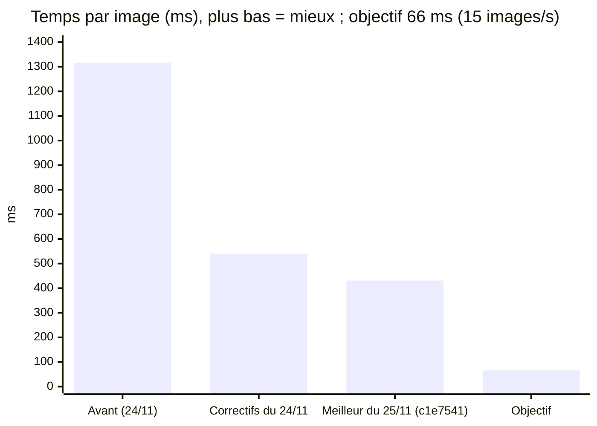

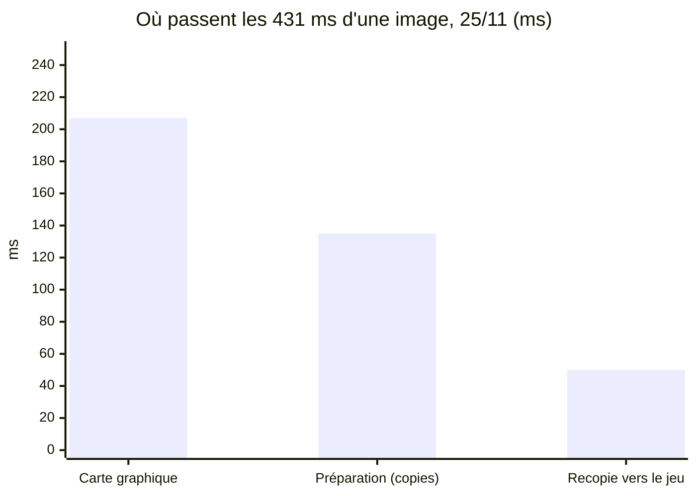

**Pourquoi 15 images/s est encore loin** : même avec une carte infiniment
rapide, la préparation et la recopie (environ 185 ms) plafonneraient le jeu
vers 5 images/s. Il faut diviser chacun des trois morceaux par 3 à 7.

### Le 25/11 : ce qui a aidé, ce qui a perdu

De 2,2 à **2,33 images/s** le 25/11 (431 ms : préparation 135, carte 207, recopie 50), puis **3,6 à 3,7** et **4,0 à 4,4 images/s** dans la nuit (230 à 250 ms : préparation 125, carte 85-100, recopie 55-70).

| Essai | Résultat | Gardé ? |
|---|---|---|
| Fenêtres de mémoire du jeu écrites par le processeur directement dans la mémoire de la carte (Resizable BAR, `VICTORY_REBAR=1`, désormais par défaut quand la carte le permet) | 4,06 → 4,19 images/s en moyenne ; mémoire partagée avec la carte 6,1 → 3,9 Go, 2,1 Go de RAM libre au lieu de moins de 0,6 | ✅ par défaut (nuit du 25/11) |
| Ces rapatriements sur une file de copie à part, au lieu d'attendre derrière tout ce qui a été envoyé entre-temps (`VICTORY_FETCH_QUEUE`) | attente des rapatriements 75 → 7 ms par image ; **3,6-3,7 → 4,0-4,4 images/s** | ✅ par défaut (nuit du 25/11) |
| Morceaux changés des copies sur la carte rapatriés par une copie, et non plus écrits par notre shader de comparaison dans la RAM du PC (`VICTORY_CARD_INLINE_FETCH` désormais coupé) | passes de comparaison 340-520 → 2,6 ms (mesure) ; dans le monde 450 → 270 ms par image, **2,2 → 3,6-3,7 images/s**, et les murs et la lumière de la cellule s'affichent | ✅ par défaut (nuit du 25/11) |
| Côté processeur des copies sur la carte en mémoire ordinaire paginable (`VICTORY_CARD_PAGEABLE`) | une partie complète de 10 minutes au lieu d'un arrêt net vers 9 minutes | ✅ par défaut |
| Copies sur place (`crate::plaincopy`, repris de fxceless `a253706`) | copies 140 → 105 ms | ✅ par défaut |
| Fenêtres sur une grille de 1 Mo, avec queues | 22,1 → 21,4 Go réservés | ✅ par défaut |
| Recopie par `plaincopy` | recopie 50 → 48 ms | ✅ |
| Compteur dans l'image (`VICTORY_HUD=0` le cache), menu `Lancer.cmd` | — | ✅ |
| Bornages indirects regroupés (`VICTORY_HOIST_CLAMPS=1`, idée de Belobug) | carte 207 → 239 ms, grillage de la fenêtre disparu | ❌ |
| Textures à 60 % de la carte | 14 600 textures en attente, vêtements en blocs | ❌ |
| Fenêtres et tampons sur la carte (90 %, 4 Go) | carte +64 ms | ❌ |
| Résolution 0,5 + éclairage simplifié | carte −80 ms mais 2,3 à 2,6 images/s et blocs | ❌ |
| Lecture sur place (`VICTORY_INPLACE`) | carte retirée au bout de 30 s (NVIDIA verrouille la section en RAM) ; à 1 Go : 2,19 images/s | ❌ sur 16 Go |
| Shaders : écriture de défaut seulement pour les pages absentes | carte 207 → 260 ms, 1,9 images/s | ❌ annulé |

### Le 25/11 au soir : ce que coûte le jeu seul, et ce que coûte notre couche

Trois essais à la cellule (RTX 3060, 16 Go), avec les modes de test :

| Par image | Normal | Sans textures, résolution basse | Sans dessin (`VICTORY_NO_DRAWS`) |
|---|---|---|---|
| Images/s | 2,3 | **3,0** (stable) | **19 à 24** |
| Temps par image | 431 ms | 333 ms | 42 à 53 ms |
| Préparation (nos copies) | 135 ms | 130 ms (85 ms pour 180 Mo copiés) | 0,4 ms |
| Carte | 207 ms | 112 ms | 0 |
| Recopie vers le jeu | 50 ms | 34 ms | 0,1 ms |
| RAM du jeu (réservée) | 21 Go | 14,4 Go | **6 Go** |
| Mémoire de la carte | 8 Go | 4 Go | — |

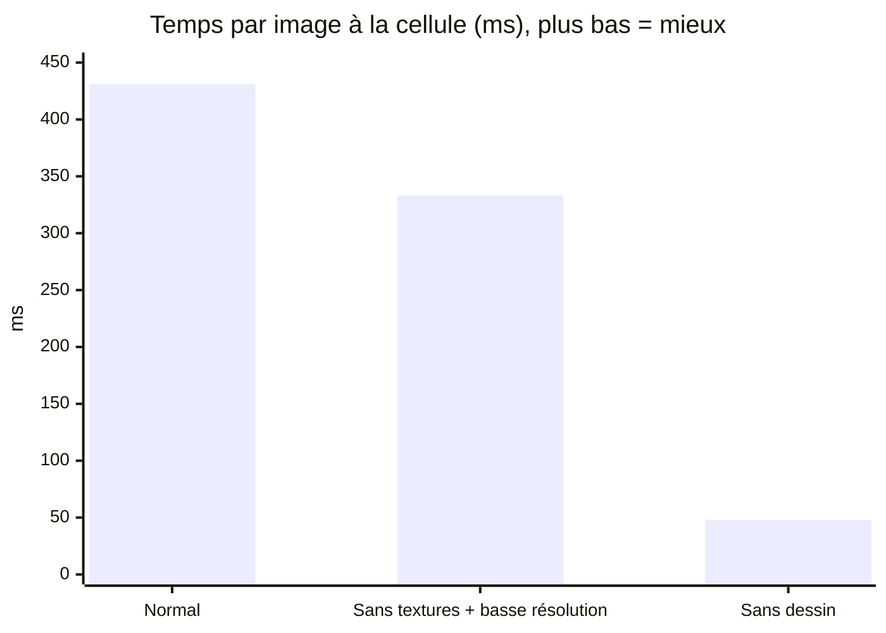

Ce qu'on en tire :

1. **Le plafond de ce PC est d'environ 20 images/s** : sans rien dessiner,
   le code du jeu (monde, personnages, chargements, son) et nos services
   système prennent 42 à 53 ms par image. Ce temps varie avec ce que le jeu
   charge : sans dessin aussi, les images ne sont pas régulières.
2. **Les 15 Go qui font déborder la RAM sont ceux de notre couche
   graphique** (6 Go sans dessin, 21 Go avec), pas ceux du jeu.
3. **Hypothèse** : textures et résolution ne sont plus le problème (sans
   elles, la carte ne passe que de 207 à 112 ms). Ce qui reste ne dépend
   pas des pixels :
   - nos **copies de la mémoire du jeu vers la carte, environ 180 Mo par
     image** (sommets, constantes, instances que le jeu change), recopiées
     à chaque image : c'est le plus gros mur, 130 ms, et il ne bouge avec
     aucun réglage ;
   - **notre travail par dessin sur la carte** (environ 2 000 bornages de
     draws indirects, chacun entouré d'une vidange, et nos comparaisons) :
     environ 110 ms quelle que soit la résolution ;
   - la **RAM pleine** (1 Go libre pendant ces essais) qui fait échanger
     Windows avec le disque.

   Le prochain vrai gain est donc de **garder les données du jeu sur la
   carte au lieu de les recopier** à chaque image (ce que vise la pile de
   ScarlettPort, et ce qui a échoué ici jusqu'à présent faute de RAM).

Autres essais du soir :

| Essai | Résultat |
|---|---|
| Bornages faits par le processeur | au plus 35 % des 2 000 bornages s'y prêtent (les autres lisent des arguments qu'un shader vient d'écrire) : au mieux environ 25 ms de carte gagnés ; pas fait |
| Copies dans la mémoire de la carte coupées (`VICTORY_CARD_BUFFERS=0`) | carte 30 à 130 ms (la moitié de nos 207 ms est donc notre propre travail de comparaison), mais préparation 490 ms et recopie 190 ms : 0,6 à 1,6 image/s, pire |
| Recopie qui ne compare que les pages écrites (VIctory `cd94d35`) | environ 100 conflits sur cette branche : à refaire à la main |

### Où va le temps de la carte (essai `VICTORY_GPU_TIMING=1`)

Aucun programme du jeu ne domine : le plus cher prend 6 ms par image.
Sur les 122 ms notées commande par commande, **80 ms vont aux 4 100 draws
indirects** (environ 20 µs chacun : le coût des passes de bornage et des
barrières qui les entourent plus que du calcul), 34 ms aux dispatchs de
calcul, le reste aux mesh, copies et envois de textures. La carte compte
environ 200 ms par image en tout : les horodatages NVIDIA ne voient pas les
vidanges entre les passes.

### Les autres forks, mesurés ou annoncés

| Fork | Carte | Images/s annoncées | Ce qui peut servir ici |
|---|---|---|---|
| Ici (25/11) | RTX 3060, 16 Go | **4,2** (mesuré) | — |
| [ScarlettPort](https://github.com/ZigZagBoi1/ScarlettPort) v0.2.1 | RTX 3060, 32 Go conseillés | environ 4 | recopie limitée aux tampons relus, attentes de lecture 156 → 26 ms. **Essayé ici le 25/11** avec leurs réglages : écran noir à l'intro, 0,4 à 0,8 image/s, 1 400 à 3 300 draws sautés faute de pipelines (leur préparation `warm` + `precompile-graphics` dure plus de 20 min, coupée) |
| [DexNom/VIctory](https://github.com/DexNom/VIctory) | RX 7900 XTX | 1,03 (ville) | ray tracing qui tourne vraiment dans la ville (Radeon) ; suivi précis des écritures des shaders (`bc3cd4b`) |
| [VItoriaBr](https://github.com/uiliannn/VItoriaBr) | RTX 5060 Ti, 40 Go | 3,5 à 6 | leur carte ne passe que 50 à 65 ms par image : la différence avec nous vient de nos comparaisons dans la mémoire de la carte et de la RAM (40 Go) |
| [ztrx](https://github.com/Zettrox/ztrx) | RTX 3050 | 1 à 3 | le code de fxceless jusqu'à `4e17478` (déjà ici) ; le prologue y va de la cellule à la poursuite en bateau, 1 h 30 sans plantage |
| [VIctory](https://github.com/Marvisak/VIctory) (`cd94d35`) | — | — | la recopie ne compare que les pages écrites |

| Par image | Avant | Après |
|---|---|---|
| Attente des pipelines | 500 ms à chaque image | 0 ms |
| Pipelines en cours de fabrication | 900 à 1 900, pendant des minutes | 0 une fois dans le monde |
| Carte graphique | 390 à 440 ms | 300 à 340 ms |
| Préparation (copies de la mémoire du jeu) | 230 à 280 ms | 130 à 160 ms |
| Recopie vers le jeu | 90 à 120 ms | 57 à 70 ms |

### Profil du 25/11 (essai 9, dans le monde)

2 à 2,5 images/s, 400 à 540 ms par image : carte graphique 100 à 220 ms,
préparation 150 à 480 ms, recopie vers le jeu environ 300 ms (sur un autre
fil, en parallèle). Le temps actif des processeurs se partage ainsi :

| Qui | Part |
|-----|------|
| Le code du jeu lui-même | 58 % |
| Copies de la mémoire du jeu vers ses copies côté PC (`Shadow::update`) | 14 % |
| Recopie de ce que la carte a écrit (`relay_land`) | 10 % |
| Surveillance des écritures (`watch::writes`) | 3,5 % |
| Lecture des fichiers du jeu, son | environ 5 % |

Nos copies passent presque toutes par le noyau de Windows, qui va chercher
sur le disque les pages échangées : la mémoire freine aussi le processeur.
Prochaine mesure : `VICTORY_GPU_TIMING=1`, pour savoir quelles commandes
occupent la carte. Objectif : 15 images/s, soit moins de 66 ms par image.

### Les modes essayés pour que la carte n'attende plus

La carte reste inactive environ 40 % du temps : le fil qui lui envoie le
travail attend qu'elle ait fini chaque envoi (environ 30 fois par image)
avant de préparer le suivant. Le fork d'origine a des modes qui envoient la
suite sans attendre. Sur ce PC (16 Go), ils sont plus lents : le travail en
vol demande plus de mémoire, qui déborde déjà.

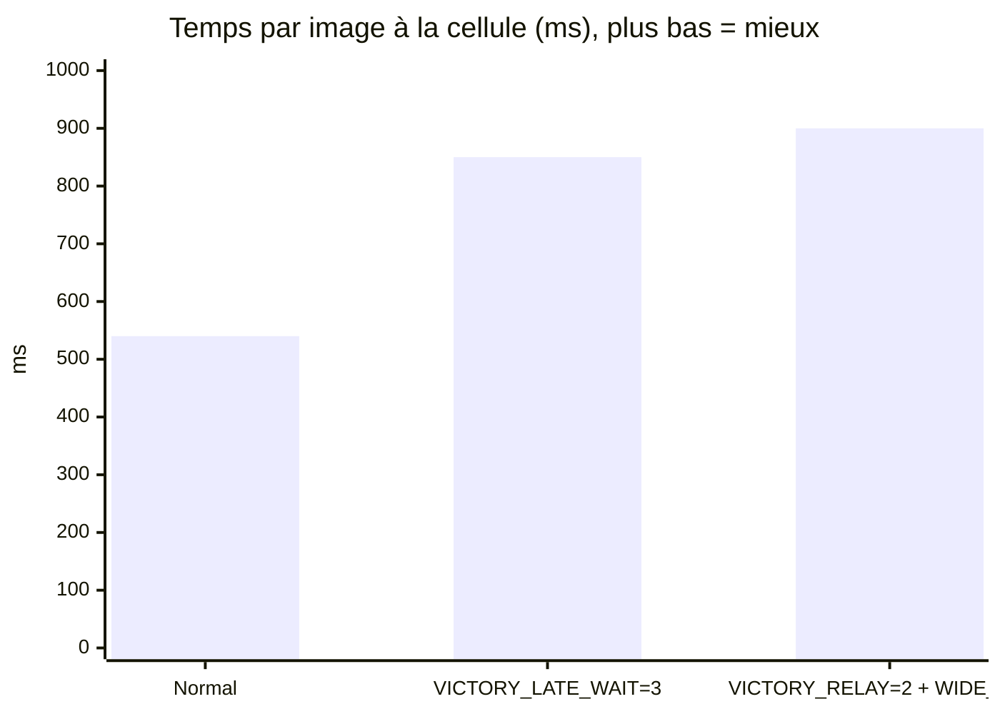

| Par image | Normal | Attente tardive | Relais |
|---|---|---|---|
| Recopie vers le jeu | ~70 ms | 170 à 300 ms | 270 à 700 ms |
| Menus | 30 fps | — | 2 à 3 fps |

Ils restent éteints par défaut.

### Les débuts de plan

À chaque changement de plan, des centaines de nouvelles textures arrivent :
la passe qui les crée et les envoie à la carte coûte alors de 150 à
1 600 ms par image (35 ms une fois la scène chargée). C'est ce qui donne les
personnages en basse qualité et les blocs pixelisés des premières secondes.
Leur préparation (lecture, empreinte, détuilage) tourne maintenant sur
plusieurs cœurs (`VICTORY_WIDE_TEXTURES=0` : sur un seul, comme avant).

Ce qui a changé : une image n'attend plus des pipelines qui ne seront pas
prêts à temps, les pipelines se fabriquent à la priorité du jeu, le cache des
pipelines (1 Go) n'est plus réécrit toutes les 20 s, et le cache des shaders
survit aux recompilations.

Ce qui limite maintenant : la carte graphique (environ 325 ms), occupée à
57 % seulement, et sa mémoire presque pleine (10,8 Go sur 12). La prochaine
mesure (`VICTORY_GPU_TIMING=1`) dira quels programmes coûtent le plus. Pour
15 images/s il faut descendre sous 66 ms.

## Mémoire

PC de test : Windows 11, carte NVIDIA, **16 Go de RAM**, fichier d'échange de
32 Go.

### Mémoire du jeu au fil du temps

Mémoire privée du processus, en Go, mesurée toutes les 15 secondes. Le saut
vers 1 min 30 correspond à l'arrivée dans le monde.

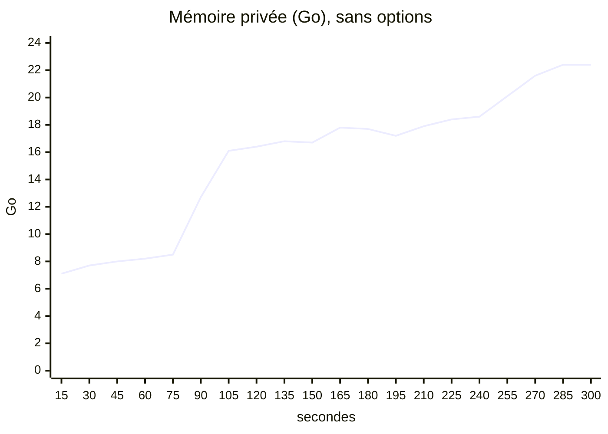

### Les lancements comparés

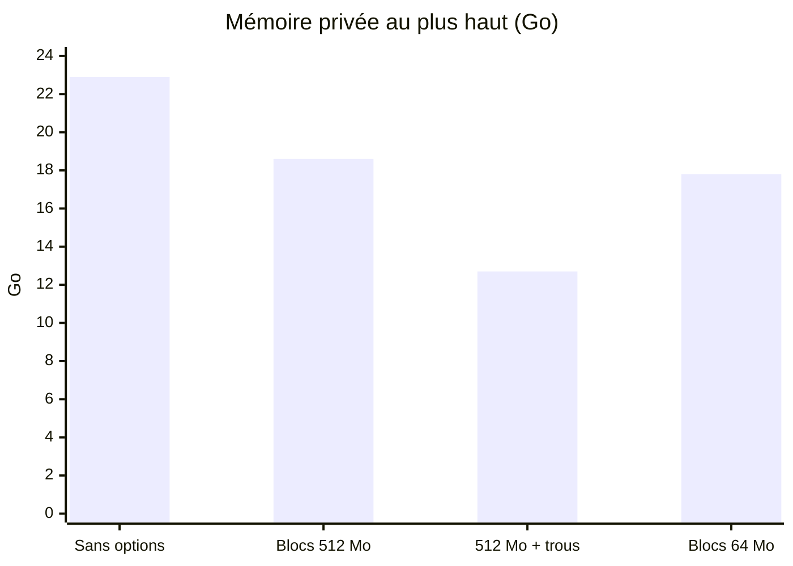

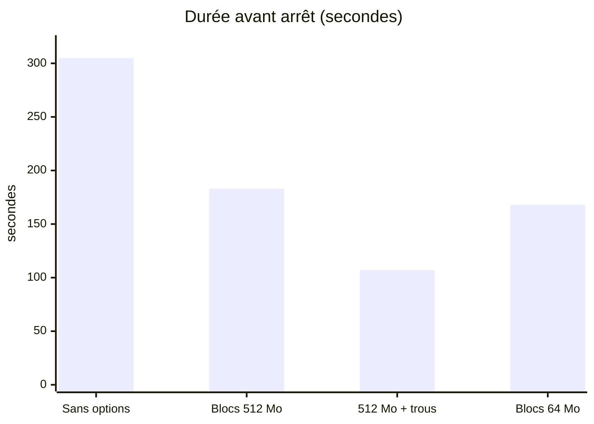

| Lancement | Mémoire au plus haut | Copies de la mémoire du jeu | Fin |
|-----------|----------------------|-----------------------------|-----|
| Sans options | 22,9 Go, en hausse | 4,2 Go | arrêté à 5 min, pas de plantage |
| `VICTORY_POOL_COMMIT=1` + `VICTORY_INPLACE=1`, blocs de 512 Mo | 18,6 Go | 4,5 Go | plantage à 183 s (RAM épuisée) |
| idem + fenêtres « à trous » | 12,7 Go | presque aucune à ce moment | plantage à 107 s (RAM épuisée) |
| idem, blocs de 64 Mo | 17,8 Go | 4,4 Go | plantage à 168 s (mémoire réservable de Windows épuisée) |

### Où va la mémoire du jeu (lancement sans options, à 5 min)

Mémoire réservée par type, en Go (toute n'est pas en RAM à la fois).

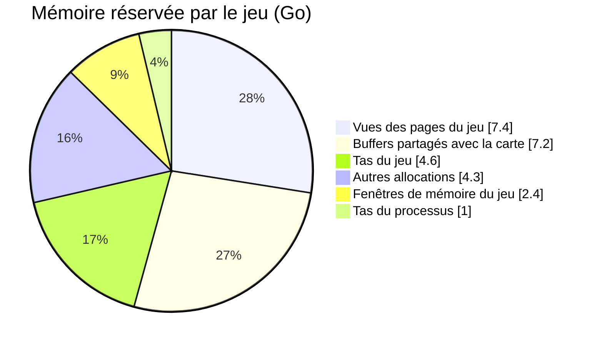

### La mémoire prise hors du jeu

Environ 7 Go sont déjà pris avant de lancer le jeu. Fermer Discord, Chrome et
Overwolf en libère environ 3,3 Go.

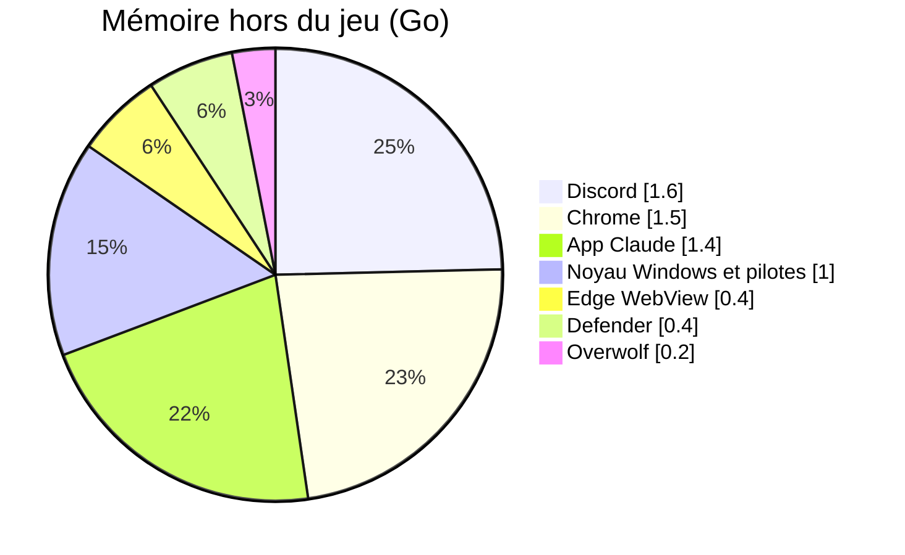

### Ce qu'on a appris

- Le pilote NVIDIA refuse d'ouvrir le pool du jeu (6,1 Go) en une seule
  section. Découpé en blocs (`VICTORY_POOL_BLOCK_MB`, 64 par défaut), chaque
  bloc s'ouvre.
- **Ouvrir une section côté carte graphique la verrouille entièrement en
  RAM**, même les pages jamais touchées. Les sections ouvertes comptent donc
  dans la limite `VICTORY_INPLACE_MB` (4096 par défaut).
- La plupart des fenêtres de 4 Mo refusées ne sont que **partiellement
  mappées** par le jeu (803 fenêtres, 3,4 Go). Très peu ont leurs pages dans le
  désordre (32, 140 Mo). Les fenêtres partielles dont les pages suivent une
  même section sont maintenant lues sans copie (`VICTORY_INPLACE_HOLES=0`
  revient à la copie).
- Pointer les tuiles d'un buffer réservé vers une section **fait perdre la
  carte NVIDIA**. Les pages dispersées ne peuvent donc pas être couvertes par
  cette voie. Test : `cargo test -p victory-gpu card_probe -- --ignored --nocapture`.
- Avec `VICTORY_POOL_COMMIT=1`, Windows réserve d'un coup 6,1 Go de plus : sur
  ce PC, le jeu plante plus tôt. **Pour l'instant, mieux vaut lancer sans les
  options mémoire.**

## Image

### Shaders

Le jeu contient 26 084 shaders ; une scène en utilise environ 2 000.
Chiffres du 26/11 (traduction hors jeu de tout `shaders.rpf`, carte en
vagues de 32 comme une RTX 3060).

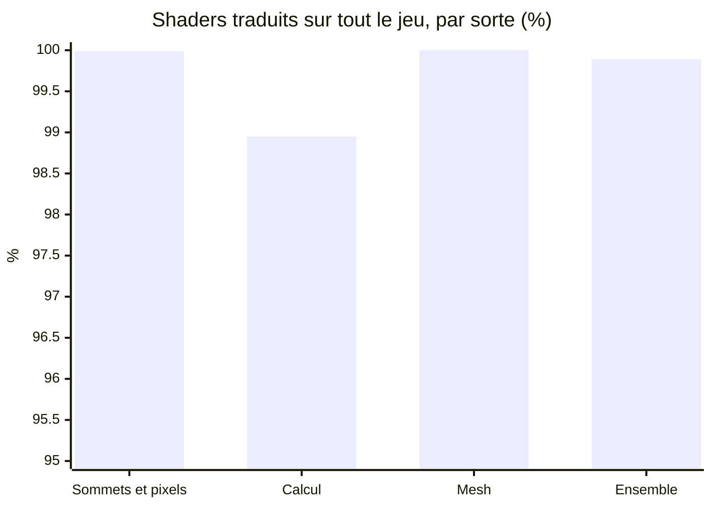

| Sorte | Traduits | Au total | % |
|---|---|---|---|
| Sommets et pixels | 14 246 | 14 247 | 99,99 % |
| Calcul | 2 654 | 2 682 | 98,95 % |
| Mesh | 8 765 | 8 765 | 100 % |
| **Ensemble** | **25 665** | **25 694** | **99,89 %** |

S'y ajoutent 195 shaders de géométrie (voxels, 0,7 % du jeu) dont les
ressources ne sont pas encore suivies : en les comptant, 98,4 % des
26 084 shaders se traduisent.

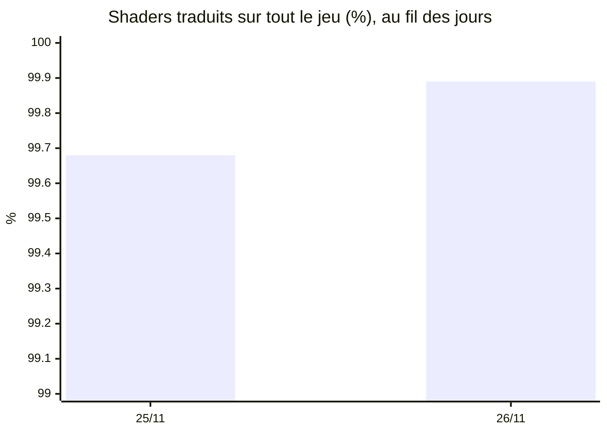

Débloqués le 26/11 : **4 traceurs d'ombres** (CS_TraceShadowRays : une
table des adresses des tampons par case du tas, reprise du runtime de
ScarlettPort, GPL-3.0) et **40 surfaces** (murs et sols PS_TexturedDeferred,
PS_TexturedLit, reflets de miroir, flaques, 3 mesh de terrain et d'ombres).
Elles choisissaient entre deux échantillonneurs fixes (répéter ou bloquer
au bord), ce qu'un handle D3D12 ne peut pas faire : chaque lecture de
texture est maintenant faite avec les deux et le bon résultat gardé.
Les 24 et 25/11 : flaques (2), simulation d'eau (1), transparence (2),
personnages à section ordonnée POPS (10, cheveux et cils).

Les 29 encore refusés, par cause :

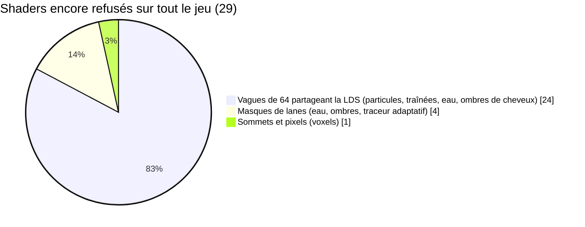

Les 24 « vagues de 64 » partagent la mémoire de groupe entre plusieurs
vagues : c'est l'étape 8 de [docs/wave64-on-wave32.md](docs/wave64-on-wave32.md),
encore ouverte (risque de bloquer la carte). Dans la scène de la cellule,
il en manque 6.

### Agrandissement de l'image (FSR)

En mode Series S, le jeu rend en 1280×720 et demande à **FSR 4** de l'agrandir
en 1920×1080. FSR 4 ne tourne pas ici (ses passes demandent une fonction du
pilote Xbox que l'on n'a pas, et ses programmes de secours sont en shader
model 5) : un **étirement simple** le remplace (`victory-gpu/src/upscale.rs`),
sans netteté ni accumulation. L'image est donc plus floue que sur console.

Expérimental (25/11) : le module d'upstream (VIctory `0b35b7f`,
`victory-hle/src/modules/fidelityfx.rs`) qui sert les appels du jeu avec le
**FSR PC d'AMD** sur la carte (FSR 3.1.6 sur une RTX). Il demande le DLL
officiel `amd_fidelityfx_upscaler_dx12.dll` du
[FidelityFX SDK](https://github.com/GPUOpen-LibrariesAndSDKs/FidelityFX-SDK)
dans un dossier donné par `VICTORY_FIDELITYFX_DIR` ; sans lui, c'est
l'étirement simple. Le jeu décrit ses images avec des formats console (une
sortie R9G9B9E5 que le PC ne sait pas écrire : image verte, bleue ou rouge
au premier essai) : les formats annoncés sont ceux de nos copies, et la
profondeur passe par une copie R32. Le deuxième essai a perdu la carte
graphique : **à ne pas utiliser pour jouer**. Le FSR n'apporterait de toute
façon que de la netteté (1 à 2 ms de carte), pas d'images/s.

Autre piste, pas encore faite : le jeu fournit au FSR tout ce dont le
**DLSS** d'NVIDIA a besoin (couleur, profondeur, vecteurs de mouvement,
jitter).

### Ray tracing

Les commits `6a2d9f9` à `7b0f736` du fork sont intégrés : les programmes
d'ombre et de tracé se traduisent, et le test rayon/boîte et rayon/triangle du
matériel est émulé. La perte de la carte graphique de ces versions venait
d'une forme « wave64 » des shaders de particules, qui met des barrières de
groupe dans des branches et des boucles. Elle est maintenant active par défaut
pour les programmes **sans boucle**, et pour ceux dont les branches élargies
sont toutes hors des boucles (`VICTORY_WAVE_WIDE=1` : partout, `0` : nulle
part).
Le ray tracing reste désactivé par défaut (`VICTORY_BVH_BUILDER=1`). Tant
qu'il l'est, une **lumière de secours** est active : le test rayon/nœud
répond « rien touché », ce qui éclaire les zones à l'ombre sans ombres de
ray tracing (`VICTORY_RT_MISS=0` la coupe). Les cinématiques de nuit restent
très sombres : leurs visages ne sont éclairés que par les contours. Détails :
[docs/fork-ray-tracing.md](docs/fork-ray-tracing.md).

## Ce qui reste à faire

1. Vitesse : ce PC plafonne vers 20 images/s (le jeu seul, mesuré sans
   dessin) ; d'ici là, les trois morceaux comptent (carte
   207 ms, préparation 135, recopie 50). Côté carte : réduire nos propres
   passes autour des 4 100 draws indirects (bornages et barrières), accélérer
   les programmes de 64 fils sur une carte à 32 voies, baisser la résolution
   des ombres en cascade. Côté processeur : reprendre la pile de ScarlettPort
   (recopie des seuls tampons relus, lectures servies sur la carte) et la
   recopie de VIctory qui ne compare que les pages écrites (`cd94d35`).
2. Traduire les shaders encore refusés (157 dans l'essai 11) : groupes de
   plusieurs vagues de 64 qui partagent leur mémoire, surfaces, volumes d'eau.
3. Faire tourner le ray tracing dans le jeu (pour l'instant, lumière de
   secours seulement).
4. Stabilité : tenir une longue partie (l'essai 11 a tenu 10 minutes).
5. Réduire la mémoire (pour ne plus échanger avec le disque sur 16 Go) : fenêtres à trous qui ne suivent pas une seule section
   (2,6 Go encore copiés), textures côté PC (3 à 4,5 Go), buffers partagés
   avec la carte (environ 7 Go réservés).
6. Essayer en jeu le reste de [docs/TESTS-A-FAIRE.md](docs/TESTS-A-FAIRE.md)
   (carte des vues, cheveux, ray tracing, logo, murs).

## Options utiles

| Variable | Effet |
|----------|-------|
| `VICTORY_POOL_COMMIT=1` | réserve le pool du jeu d'un coup (nécessaire pour l'ouvrir sur la carte) |
| `VICTORY_POOL_BLOCK_MB` | taille des blocs du pool (64 par défaut) |
| `VICTORY_INPLACE=1` | lit la mémoire du jeu sans copie quand c'est possible |
| `VICTORY_INPLACE_MB` | mémoire verrouillée au plus pour cela (4096 par défaut) |
| `VICTORY_INPLACE_HOLES=0` | recopie les fenêtres partiellement mappées |
| `VICTORY_PIPELINE_WAIT_MS` | attente maximale des pipelines par image (500 par défaut) |
| `VICTORY_PIPELINE_WAIT_BACKLOG` | au-delà de ce nombre de pipelines en retard (16), une image ne les attend plus ; `0` : toujours attendre |
| `VICTORY_PIPELINE_LOW_PRIORITY=1` | fabrique les pipelines en priorité basse, comme avant |
| `VICTORY_SHADER_KEY_EXE=1` | cache des shaders lié à tout l'exécutable, comme avant |
| `VICTORY_GPU_TIMING=1` | temps de chaque commande sur la carte, par programme |
| `VICTORY_TEXTURE_SWEEP=0` | ne libère jamais les textures inutilisées |
| `VICTORY_SKIP_PIPELINES=<hash>,...` | saute les dessins des programmes listés (pour comparer) |
| `VICTORY_WIDE_TEXTURES=0` | prépare les textures sur un seul cœur, comme avant |
| `VICTORY_LATE_WAIT=0` | attend la carte après chaque envoi, comme avant (par défaut : envoie la suite sans attendre, 450-480 ms par image au lieu de 560-610) |
| `VICTORY_INDIRECT_WINDOW=0` | vérifie les dessins indirects un par un, comme avant (par défaut : jusqu'à 64 d'un coup, plus rapide et les murs reviennent) |
| `VICTORY_WIDE_REFRESH=1` | copies de la mémoire du jeu sur plusieurs cœurs (en essai) |
| `VICTORY_RELAY=2`, `VICTORY_LATE_WAIT=3` | envoi sans attendre la carte : plus lent sur un PC de 16 Go |
| `VICTORY_MISSING_LOG=1` | `translate` : dit quelle instruction n'a pas de valeur et pourquoi |
| `VICTORY_D3D12_DEBUG=1` | couche de débogage Direct3D (build `diag`), nomme les erreurs |
| `VICTORY_BVH_BUILDER=1` | active la construction des structures de ray tracing |
| `VICTORY_WAVE_WIDE` | forme wave64 « vague entière » : par défaut sans boucle seulement ; `1` partout, `0` nulle part |
| `VICTORY_WAVE_LOCAL=idiom` | seulement les formes exactes des programmes wave64 |
| `VICTORY_RT_MISS` | lumière de secours (rayons qui ne touchent rien) : active par défaut tant que le constructeur est éteint ; `0` la coupe |
| `VICTORY_HEAP_MAP=0` | coupe la carte des vues de VIcky |
| `VICTORY_TEXTURE_NO_WAIT=0` | les textures attendent les remappages du jeu (avant : défaut) |
| `VICTORY_CARD_BUFFERS_MIN_MB` | taille dès laquelle la carte compare les buffers au lieu du processeur (1 Mo par défaut, avant 16) |
| `VICTORY_PROFILE=4` | profileur (build `diag`) |
