# VIctory : GTA VI (Xbox Series) sur PC, avancement

Version de travail de [VIctory](https://github.com/Marvisak/VIctory), qui fait
tourner la version Xbox Series de Grand Theft Auto VI directement sous Windows,
à partir des fichiers du jeu que l'utilisateur fournit. Elle part du fork
[fxceless/victory-gta6](https://github.com/fxceless/victory-gta6) (commit
`578d459`) et de ses commits suivants, jusqu'à `4e17478`, plus la « carte des
vues » de [Xeltax/VIcky](https://github.com/Xeltax/VIcky) (branche
`fx-heapmap`).

**Ce dépôt ne contient aucun fichier du jeu** : ni exécutable, ni données, ni
shaders extraits. Il faut sa propre copie du jeu. Ce projet n'est ni affilié à
Rockstar Games ou Take-Two Interactive, ni approuvé par eux.

Mis à jour le 25/11/2026.

## Crédits et licence

- **[VIctory](https://github.com/Marvisak/VIctory)**, par Marvisak et ses
  contributeurs, est la base de tout : le chargeur, les services du système,
  le rendu Direct3D 12 et le recompilateur de shaders. Licence
  GPL-3.0-or-later, comme ce dépôt (voir `LICENSE`).
- **[victory-gta6](https://github.com/fxceless/victory-gta6)**, par fxceless :
  le fork dont part ce travail (rendu du monde, ray tracing en cours).
- **[VIcky](https://github.com/Xeltax/VIcky)**, par Xeltax : la carte des vues
  pour la limite d'un million de vues des cartes NVIDIA.
- **[XCL](https://github.com/ivall/xcl)**, par ivall (GPL-2.0-only), a servi de
  référence pour le comportement du jeu sous une autre couche.
- Le texte d'origine, en anglais, est dans
  [docs/README-original.en.md](docs/README-original.en.md).
- Développé avec [Claude Code](https://claude.com/claude-code).

## Où en est le jeu

### Avancement du portage : environ 59 %

`████████████░░░░░░░░` **environ 59 % : jouable** (on dirige Lucia dans le prologue)

Mesuré avec le barème de [PortWatch VI](https://portwatch-vi.xyz/#method) :
jusqu'à 50 %, chaque étape demande la précédente ; au-delà, l'histoire, le
rendu, la vitesse et la stabilité se partagent les 50 derniers points. Ces
points-là sont notre estimation : PortWatch ne les compte qu'avec une
preuve (une vidéo).

| Palier | % | État |
|--------|---|------|
| Fondations (chargeur, bibliothèques, shaders, rendu D3D12) | 0-10 | ✅ |
| L'exécutable tourne | 10 | ✅ |
| Première image (logos, intro) | 20 | ✅ |
| Menu principal | 30 | ✅ |
| Dans le monde (le prologue se charge et s'affiche) | 40 | ✅ |
| Jouable (on dirige un personnage) | 50 | ✅ Lucia bouge dans le prologue |
| Histoire (17,5 points) | 0 | ⏳ encore dans l'ouverture ; finir le prologue en rapporte environ 3 |
| Rendu (12,5 points) | environ 6 | ⚠️ éclairé, mais de gros effets manquent (ombre, ray tracing) |
| Vitesse (10 points : images/s ÷ 30) | environ 0,8 | ❌ 2,3 images/s (meilleur essai du 25/11) ; objectif 15 |
| Stabilité (10 points) | environ 2,5 | ⚠️ pas encore mesurée sur une longue partie |

### Détail

| Étape | État |
|-------|------|
| Démarrage, menus, écran titre | ✅ fonctionne |
| Cinématique d'intro | ✅ se joue en entier et s'affiche correctement (vérifié en jeu le 25/11) |
| Sauvegardes | ✅ le jeu sauvegarde et recharge un point de passage |
| Premier passage jouable (prologue) | ✅ on dirige Lucia ; s'affiche : personnages, textures, ciel, extérieur au soleil |
| Lumière dans l'ombre | ⚠️ lumière de secours par défaut : intérieurs et visages éclairés, mais certaines cinématiques restent presque noires (le ray tracing du jeu ne tourne pas encore). Les essais 8 et 9 étaient plus sombres à cause d'un blocage des textures quand la mémoire était basse, retiré le 25/11 (commit `3b5bcb6`) |
| Images par seconde dans le monde | ❌ 2,3 (431 ms par image) sur RTX 3060 et 16 Go de RAM, carte occupée à 82 % ; 30 dans les menus |
| Mémoire | ❌ 18 à 22 Go réservés, 5 à 9 Go en RAM sur un PC de 16 Go (Windows échange avec le disque) ; au plus bas, 150 Mo restaient à engager sur 39,6 Go |
| Stabilité | ⚠️ essai 11 (25/11) : 10 minutes sans plantage. Quand le PC n'a plus de mémoire à engager, le jeu se ferme sans rapport : un fichier d'échange de 32 Go au moins l'évite. Un débordement de pile est maintenant rapporté au lieu de fermer la fenêtre en silence |

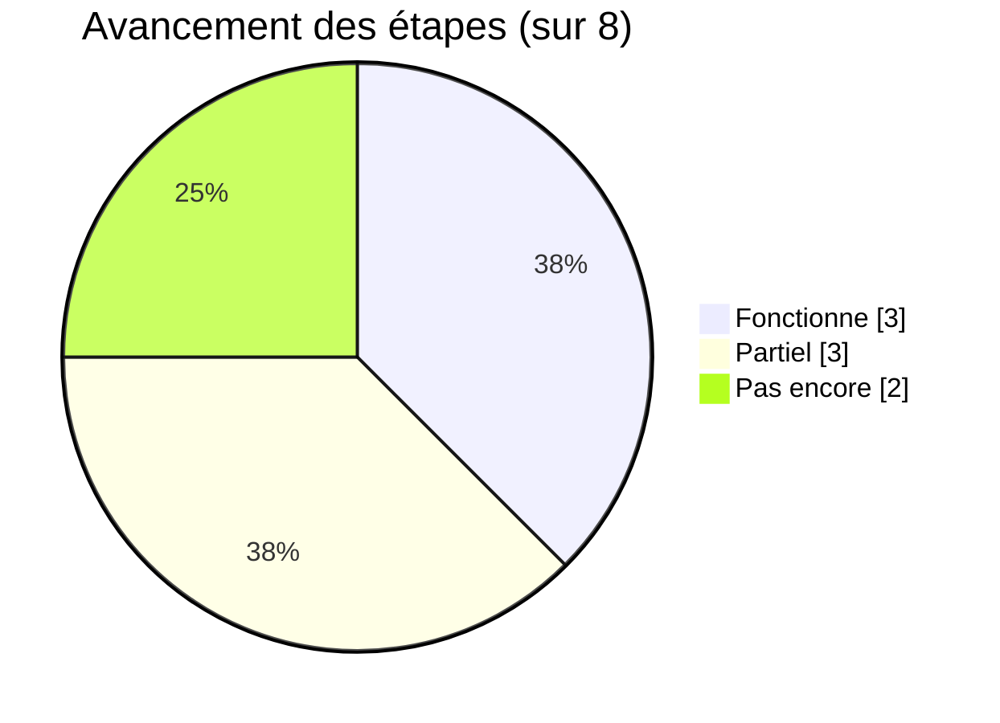

## Lancer

```powershell
cargo build --profile diag -p victory --features diagnostics
target\diag\victory.exe run "D:\chemin\vers\game_scarlett_master.exe" --execute
```

Le chemin du jeu peut aussi être mis dans `victory.toml` (modèle :
`victory.example.toml`).

### Réglages conseillés (PC de 16 Go)

- **Mode Series S** : ajouter `--console series-s` à la commande. Le jeu se
  croit sur Xbox Series S et choisit ses réglages plus légers (résolution,
  budgets de mémoire) : c'est le mode utilisé pour les essais récents.

  ```powershell
  target\diag\victory.exe run "D:\chemin\vers\game_scarlett_master.exe" --execute --console series-s
  ```

- **Fichier d'échange de 32 Go au moins** (Paramètres système avancés →
  Performances → Mémoire virtuelle). Le jeu engage environ 21 Go : avec le
  fichier d'échange par défaut, Windows n'a plus de mémoire à engager et le
  jeu se ferme sans rapport.
- **Lumière de secours** : active par défaut (`VICTORY_RT_MISS`), tant que le
  ray tracing du jeu ne tourne pas. Elle éclaire les zones à l'ombre ;
  `VICTORY_RT_MISS=0` la coupe pour comparer.
- À l'écran titre, appuyer sur **A** (Entrée au clavier).

Les options de vitesse d'avant (`VICTORY_TEXTURE_NO_WAIT`,
`VICTORY_CARD_BUFFERS_MIN_MB`, `VICTORY_CARD_BUFFERS_MB`) sont maintenant
actives par défaut : la commande ci-dessus suffit.

**Avant de jouer, et après chaque mise à jour du traducteur de shaders** :
double-cliquer sur `Prechauffer.cmd` (ou `victory.exe translate --cache`).
Il traduit d'avance tous les shaders du jeu (25 674 sur environ 26 000)
dans le cache, comme une partie le ferait, pour que le jeu ne le fasse pas
en pleine partie : quelques minutes la première fois. Sans lui, le premier
lancement les traduit au fil de l'eau : image noire ou cassée pendant
plusieurs minutes. Recompiler le reste de `victory.exe` ne vide plus ce
cache (il ne dépend plus que du code du traducteur). Ce qui reste à essayer en jeu est décrit dans
[docs/TESTS-A-FAIRE.md](docs/TESTS-A-FAIRE.md).

## Vitesse

Temps par image dans le monde, en millisecondes (scène de la cellule, carte
RTX 3060, 16 Go de RAM, mode Series S).

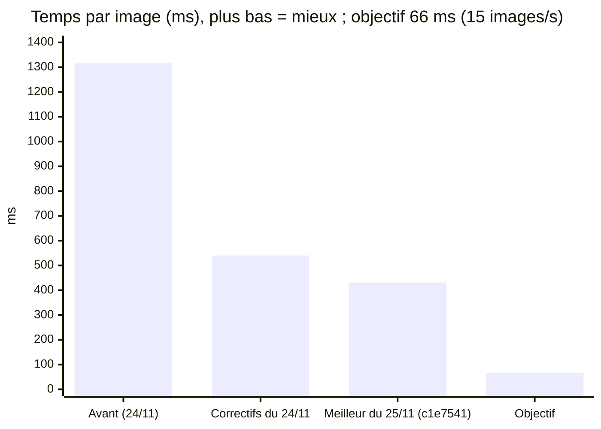

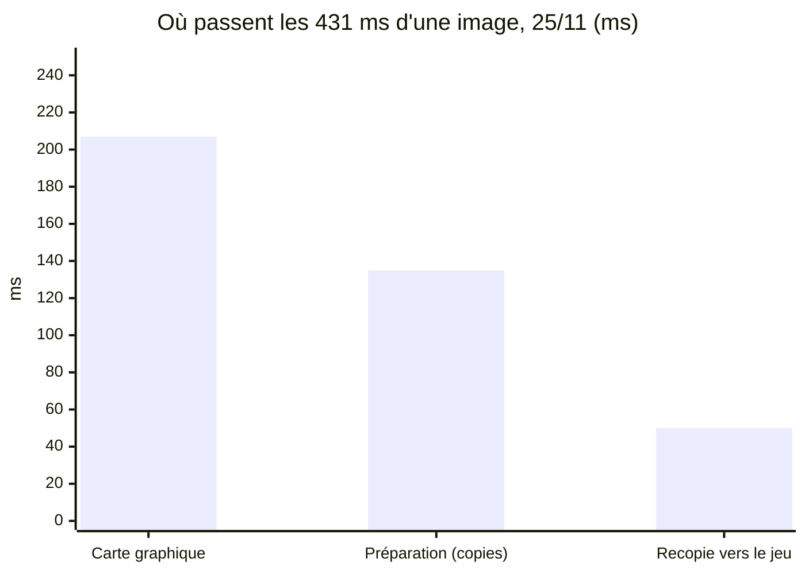

**Pourquoi 15 images/s est encore loin** : même avec une carte infiniment
rapide, la préparation et la recopie (environ 185 ms) plafonneraient le jeu
vers 5 images/s. Il faut diviser chacun des trois morceaux par 3 à 7.

### Le 25/11 : ce qui a aidé, ce qui a perdu

De 2,2 à **2,33 images/s** (431 ms : préparation 135, carte 207, recopie 50).

| Essai | Résultat | Gardé ? |
|---|---|---|
| Copies sur place (`crate::plaincopy`, repris de fxceless `a253706`) | copies 140 → 105 ms | ✅ par défaut |
| Fenêtres sur une grille de 1 Mo, avec queues | 22,1 → 21,4 Go réservés | ✅ par défaut |
| Recopie par `plaincopy` | recopie 50 → 48 ms | ✅ |
| Compteur dans l'image (`VICTORY_HUD=0` le cache), menu `Lancer.cmd` | — | ✅ |
| Bornages indirects regroupés (`VICTORY_HOIST_CLAMPS=1`, idée de Belobug) | carte 207 → 239 ms, grillage de la fenêtre disparu | ❌ |
| Textures à 60 % de la carte | 14 600 textures en attente, vêtements en blocs | ❌ |
| Fenêtres et tampons sur la carte (90 %, 4 Go) | carte +64 ms | ❌ |
| Résolution 0,5 + éclairage simplifié | carte −80 ms mais 2,3 à 2,6 images/s et blocs | ❌ |
| Lecture sur place (`VICTORY_INPLACE`) | carte retirée au bout de 30 s (NVIDIA verrouille la section en RAM) ; à 1 Go : 2,19 images/s | ❌ sur 16 Go |
| Shaders : écriture de défaut seulement pour les pages absentes | carte 207 → 260 ms, 1,9 images/s | ❌ annulé |

### Où va le temps de la carte (essai `VICTORY_GPU_TIMING=1`)

Aucun programme du jeu ne domine : le plus cher prend 6 ms par image.
Sur les 122 ms notées commande par commande, **80 ms vont aux 4 100 draws
indirects** (environ 20 µs chacun : le coût des passes de bornage et des
barrières qui les entourent plus que du calcul), 34 ms aux dispatchs de
calcul, le reste aux mesh, copies et envois de textures. La carte compte
environ 200 ms par image en tout : les horodatages NVIDIA ne voient pas les
vidanges entre les passes.

### Les autres forks, mesurés ou annoncés

| Fork | Carte | Images/s annoncées | Ce qui peut servir ici |
|---|---|---|---|
| Ici (25/11) | RTX 3060, 16 Go | **2,3** (mesuré) | — |
| [ScarlettPort](https://github.com/ZigZagBoi1/ScarlettPort) v0.2.1 | RTX 3060, 32 Go conseillés | environ 4 | recopie limitée aux tampons relus, attentes de lecture 156 → 26 ms. **Essayé ici le 25/11** avec leurs réglages : écran noir à l'intro, 0,4 à 0,8 image/s, 1 400 à 3 300 draws sautés faute de pipelines (leur préparation `warm` + `precompile-graphics` dure plus de 20 min, coupée) |
| [DexNom/VIctory](https://github.com/DexNom/VIctory) | RX 7900 XTX | 1,03 (ville) | suivi précis des écritures des shaders (`bc3cd4b`) |
| [VIctory](https://github.com/Marvisak/VIctory) (`cd94d35`) | — | — | la recopie ne compare que les pages écrites |

| Par image | Avant | Après |
|---|---|---|
| Attente des pipelines | 500 ms à chaque image | 0 ms |
| Pipelines en cours de fabrication | 900 à 1 900, pendant des minutes | 0 une fois dans le monde |
| Carte graphique | 390 à 440 ms | 300 à 340 ms |
| Préparation (copies de la mémoire du jeu) | 230 à 280 ms | 130 à 160 ms |
| Recopie vers le jeu | 90 à 120 ms | 57 à 70 ms |

### Profil du 25/11 (essai 9, dans le monde)

2 à 2,5 images/s, 400 à 540 ms par image : carte graphique 100 à 220 ms,
préparation 150 à 480 ms, recopie vers le jeu environ 300 ms (sur un autre
fil, en parallèle). Le temps actif des processeurs se partage ainsi :

| Qui | Part |
|-----|------|
| Le code du jeu lui-même | 58 % |
| Copies de la mémoire du jeu vers ses copies côté PC (`Shadow::update`) | 14 % |
| Recopie de ce que la carte a écrit (`relay_land`) | 10 % |
| Surveillance des écritures (`watch::writes`) | 3,5 % |
| Lecture des fichiers du jeu, son | environ 5 % |

Nos copies passent presque toutes par le noyau de Windows, qui va chercher
sur le disque les pages échangées : la mémoire freine aussi le processeur.
Prochaine mesure : `VICTORY_GPU_TIMING=1`, pour savoir quelles commandes
occupent la carte. Objectif : 15 images/s, soit moins de 66 ms par image.

### Les modes essayés pour que la carte n'attende plus

La carte reste inactive environ 40 % du temps : le fil qui lui envoie le
travail attend qu'elle ait fini chaque envoi (environ 30 fois par image)
avant de préparer le suivant. Le fork d'origine a des modes qui envoient la
suite sans attendre. Sur ce PC (16 Go), ils sont plus lents : le travail en
vol demande plus de mémoire, qui déborde déjà.

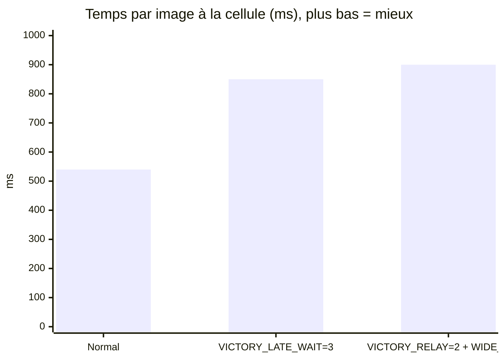

| Par image | Normal | Attente tardive | Relais |
|---|---|---|---|
| Recopie vers le jeu | ~70 ms | 170 à 300 ms | 270 à 700 ms |
| Menus | 30 fps | — | 2 à 3 fps |

Ils restent éteints par défaut.

### Les débuts de plan

À chaque changement de plan, des centaines de nouvelles textures arrivent :
la passe qui les crée et les envoie à la carte coûte alors de 150 à
1 600 ms par image (35 ms une fois la scène chargée). C'est ce qui donne les
personnages en basse qualité et les blocs pixelisés des premières secondes.
Leur préparation (lecture, empreinte, détuilage) tourne maintenant sur
plusieurs cœurs (`VICTORY_WIDE_TEXTURES=0` : sur un seul, comme avant).

Ce qui a changé : une image n'attend plus des pipelines qui ne seront pas
prêts à temps, les pipelines se fabriquent à la priorité du jeu, le cache des
pipelines (1 Go) n'est plus réécrit toutes les 20 s, et le cache des shaders
survit aux recompilations.

Ce qui limite maintenant : la carte graphique (environ 325 ms), occupée à
57 % seulement, et sa mémoire presque pleine (10,8 Go sur 12). La prochaine
mesure (`VICTORY_GPU_TIMING=1`) dira quels programmes coûtent le plus. Pour
15 images/s il faut descendre sous 66 ms.

## Mémoire

PC de test : Windows 11, carte NVIDIA, **16 Go de RAM**, fichier d'échange de
32 Go.

### Mémoire du jeu au fil du temps

Mémoire privée du processus, en Go, mesurée toutes les 15 secondes. Le saut
vers 1 min 30 correspond à l'arrivée dans le monde.

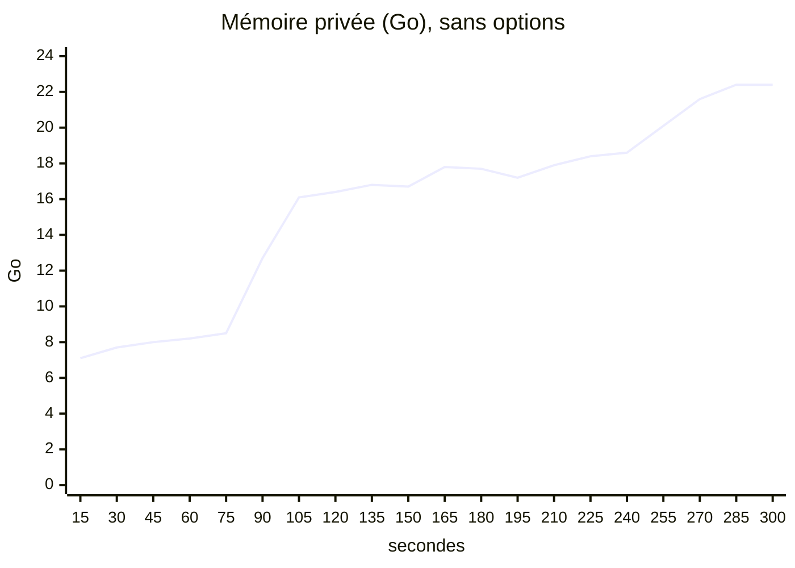

### Les lancements comparés

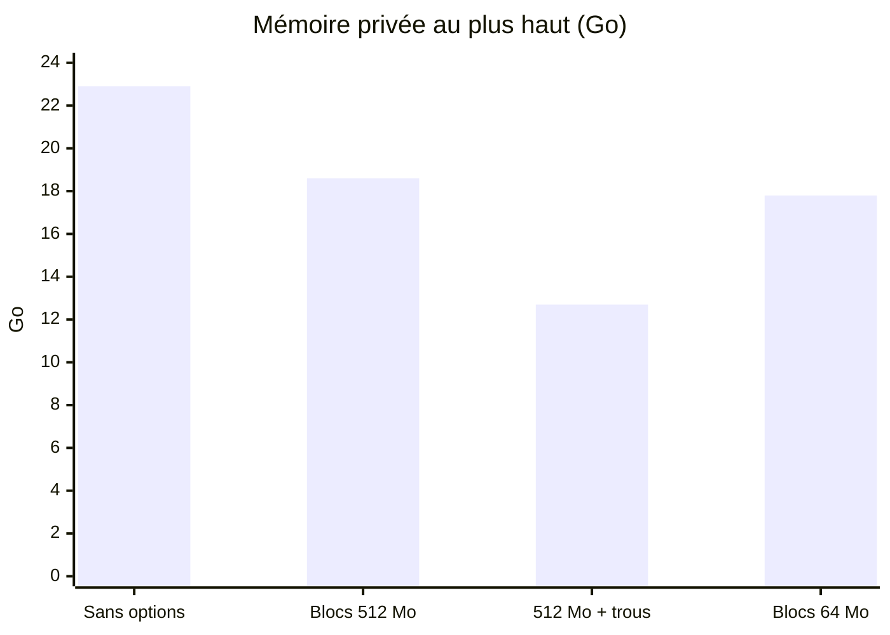

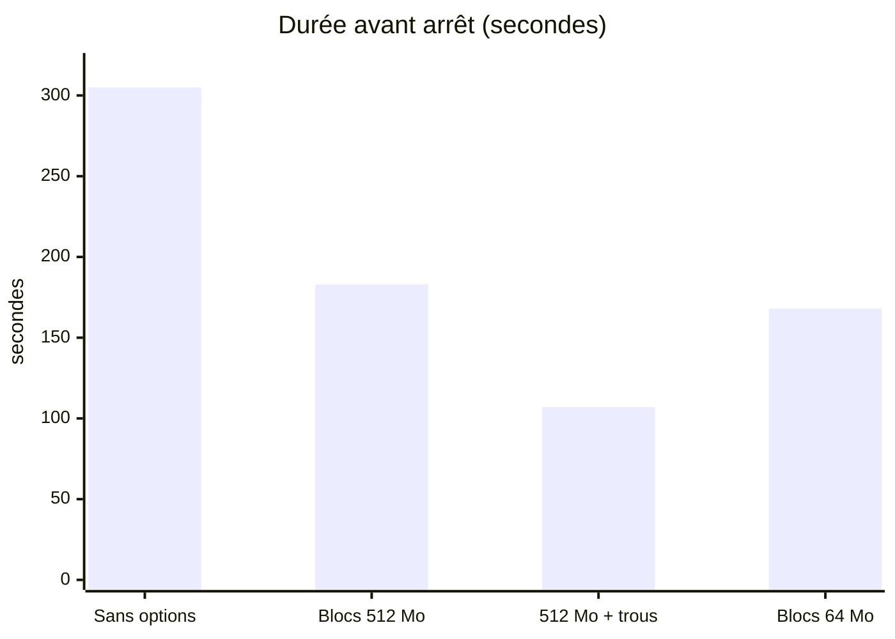

| Lancement | Mémoire au plus haut | Copies de la mémoire du jeu | Fin |
|-----------|----------------------|-----------------------------|-----|
| Sans options | 22,9 Go, en hausse | 4,2 Go | arrêté à 5 min, pas de plantage |
| `VICTORY_POOL_COMMIT=1` + `VICTORY_INPLACE=1`, blocs de 512 Mo | 18,6 Go | 4,5 Go | plantage à 183 s (RAM épuisée) |
| idem + fenêtres « à trous » | 12,7 Go | presque aucune à ce moment | plantage à 107 s (RAM épuisée) |
| idem, blocs de 64 Mo | 17,8 Go | 4,4 Go | plantage à 168 s (mémoire réservable de Windows épuisée) |

### Où va la mémoire du jeu (lancement sans options, à 5 min)

Mémoire réservée par type, en Go (toute n'est pas en RAM à la fois).

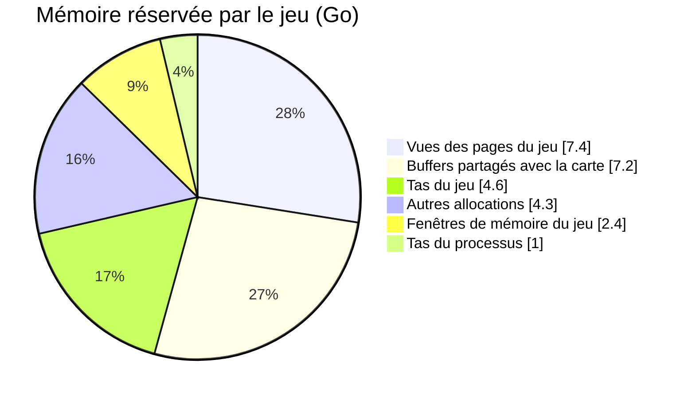

### La mémoire prise hors du jeu

Environ 7 Go sont déjà pris avant de lancer le jeu. Fermer Discord, Chrome et
Overwolf en libère environ 3,3 Go.

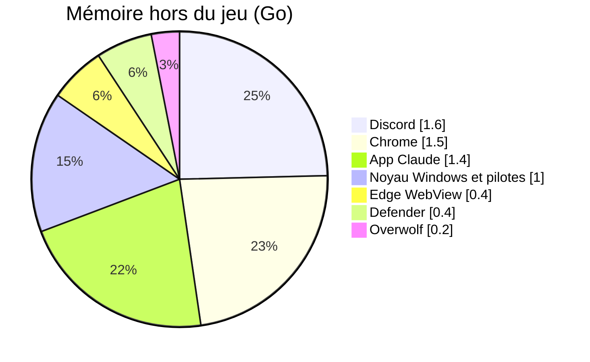

### Ce qu'on a appris

- Le pilote NVIDIA refuse d'ouvrir le pool du jeu (6,1 Go) en une seule
  section. Découpé en blocs (`VICTORY_POOL_BLOCK_MB`, 64 par défaut), chaque
  bloc s'ouvre.
- **Ouvrir une section côté carte graphique la verrouille entièrement en
  RAM**, même les pages jamais touchées. Les sections ouvertes comptent donc
  dans la limite `VICTORY_INPLACE_MB` (4096 par défaut).
- La plupart des fenêtres de 4 Mo refusées ne sont que **partiellement
  mappées** par le jeu (803 fenêtres, 3,4 Go). Très peu ont leurs pages dans le
  désordre (32, 140 Mo). Les fenêtres partielles dont les pages suivent une
  même section sont maintenant lues sans copie (`VICTORY_INPLACE_HOLES=0`
  revient à la copie).
- Pointer les tuiles d'un buffer réservé vers une section **fait perdre la
  carte NVIDIA**. Les pages dispersées ne peuvent donc pas être couvertes par
  cette voie. Test : `cargo test -p victory-gpu card_probe -- --ignored --nocapture`.
- Avec `VICTORY_POOL_COMMIT=1`, Windows réserve d'un coup 6,1 Go de plus : sur
  ce PC, le jeu plante plus tôt. **Pour l'instant, mieux vaut lancer sans les
  options mémoire.**

## Image

### Shaders

Le jeu contient 26 084 shaders ; une scène en utilise environ 2 000.
Chiffres du 26/11 (traduction hors jeu de tout `shaders.rpf`, carte en
vagues de 32 comme une RTX 3060).

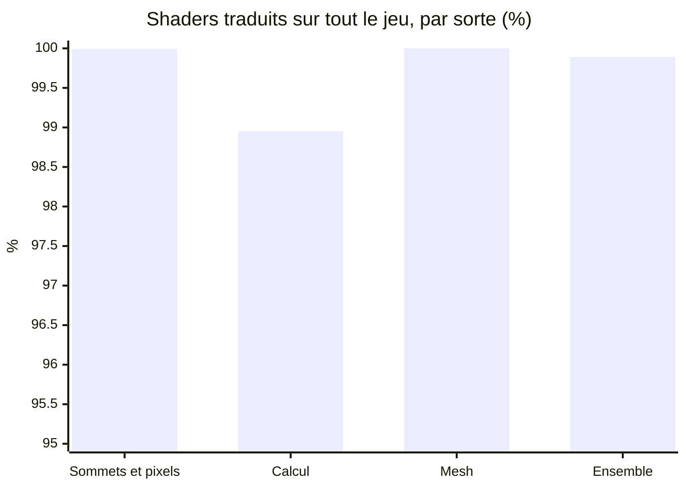

| Sorte | Traduits | Au total | % |
|---|---|---|---|
| Sommets et pixels | 14 246 | 14 247 | 99,99 % |
| Calcul | 2 654 | 2 682 | 98,95 % |
| Mesh | 8 765 | 8 765 | 100 % |
| **Ensemble** | **25 665** | **25 694** | **99,89 %** |

S'y ajoutent 195 shaders de géométrie (voxels, 0,7 % du jeu) dont les
ressources ne sont pas encore suivies : en les comptant, 98,4 % des
26 084 shaders se traduisent.

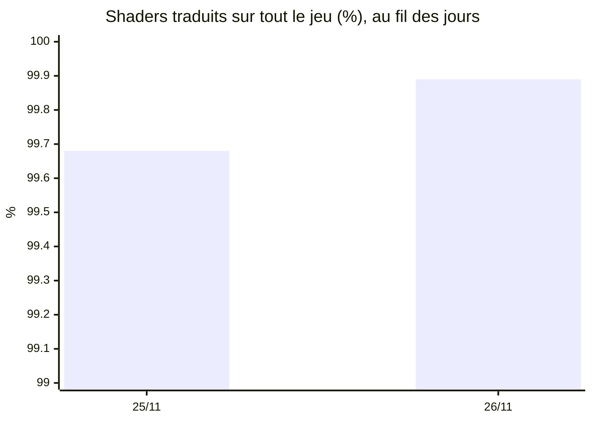

Débloqués le 26/11 : **4 traceurs d'ombres** (CS_TraceShadowRays : une
table des adresses des tampons par case du tas, reprise du runtime de
ScarlettPort, GPL-3.0) et **40 surfaces** (murs et sols PS_TexturedDeferred,
PS_TexturedLit, reflets de miroir, flaques, 3 mesh de terrain et d'ombres).
Elles choisissaient entre deux échantillonneurs fixes (répéter ou bloquer
au bord), ce qu'un handle D3D12 ne peut pas faire : chaque lecture de
texture est maintenant faite avec les deux et le bon résultat gardé.
Les 24 et 25/11 : flaques (2), simulation d'eau (1), transparence (2),
personnages à section ordonnée POPS (10, cheveux et cils).

Les 29 encore refusés, par cause :

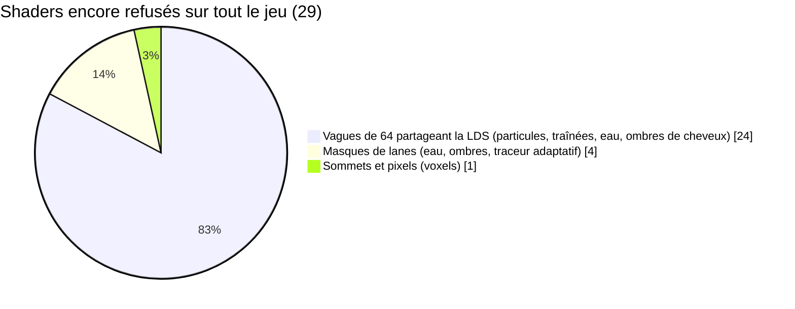

Les 24 « vagues de 64 » partagent la mémoire de groupe entre plusieurs
vagues : c'est l'étape 8 de [docs/wave64-on-wave32.md](docs/wave64-on-wave32.md),
encore ouverte (risque de bloquer la carte). Dans la scène de la cellule,
il en manque 6.

### Ray tracing

Les commits `6a2d9f9` à `7b0f736` du fork sont intégrés : les programmes
d'ombre et de tracé se traduisent, et le test rayon/boîte et rayon/triangle du
matériel est émulé. La perte de la carte graphique de ces versions venait
d'une forme « wave64 » des shaders de particules, qui met des barrières de
groupe dans des branches et des boucles. Elle est maintenant active par défaut
pour les programmes **sans boucle**, et pour ceux dont les branches élargies
sont toutes hors des boucles (`VICTORY_WAVE_WIDE=1` : partout, `0` : nulle
part).
Le ray tracing reste désactivé par défaut (`VICTORY_BVH_BUILDER=1`). Tant
qu'il l'est, une **lumière de secours** est active : le test rayon/nœud
répond « rien touché », ce qui éclaire les zones à l'ombre sans ombres de
ray tracing (`VICTORY_RT_MISS=0` la coupe). Les cinématiques de nuit restent
très sombres : leurs visages ne sont éclairés que par les contours. Détails :
[docs/fork-ray-tracing.md](docs/fork-ray-tracing.md).

## Ce qui reste à faire

1. Vitesse (de 2,3 à 15 images/s) : les trois morceaux comptent (carte
   207 ms, préparation 135, recopie 50). Côté carte : réduire nos propres
   passes autour des 4 100 draws indirects (bornages et barrières), accélérer
   les programmes de 64 fils sur une carte à 32 voies, baisser la résolution
   des ombres en cascade. Côté processeur : reprendre la pile de ScarlettPort
   (recopie des seuls tampons relus, lectures servies sur la carte) et la
   recopie de VIctory qui ne compare que les pages écrites (`cd94d35`).
2. Traduire les shaders encore refusés (157 dans l'essai 11) : groupes de
   plusieurs vagues de 64 qui partagent leur mémoire, surfaces, volumes d'eau.
3. Faire tourner le ray tracing dans le jeu (pour l'instant, lumière de
   secours seulement).
4. Stabilité : tenir une longue partie (l'essai 11 a tenu 10 minutes).
5. Réduire la mémoire (pour ne plus échanger avec le disque sur 16 Go) : fenêtres à trous qui ne suivent pas une seule section
   (2,6 Go encore copiés), textures côté PC (3 à 4,5 Go), buffers partagés
   avec la carte (environ 7 Go réservés).
6. Essayer en jeu le reste de [docs/TESTS-A-FAIRE.md](docs/TESTS-A-FAIRE.md)
   (carte des vues, cheveux, ray tracing, logo, murs).

## Options utiles

| Variable | Effet |
|----------|-------|
| `VICTORY_POOL_COMMIT=1` | réserve le pool du jeu d'un coup (nécessaire pour l'ouvrir sur la carte) |
| `VICTORY_POOL_BLOCK_MB` | taille des blocs du pool (64 par défaut) |
| `VICTORY_INPLACE=1` | lit la mémoire du jeu sans copie quand c'est possible |
| `VICTORY_INPLACE_MB` | mémoire verrouillée au plus pour cela (4096 par défaut) |
| `VICTORY_INPLACE_HOLES=0` | recopie les fenêtres partiellement mappées |
| `VICTORY_PIPELINE_WAIT_MS` | attente maximale des pipelines par image (500 par défaut) |
| `VICTORY_PIPELINE_WAIT_BACKLOG` | au-delà de ce nombre de pipelines en retard (16), une image ne les attend plus ; `0` : toujours attendre |
| `VICTORY_PIPELINE_LOW_PRIORITY=1` | fabrique les pipelines en priorité basse, comme avant |
| `VICTORY_SHADER_KEY_EXE=1` | cache des shaders lié à tout l'exécutable, comme avant |
| `VICTORY_GPU_TIMING=1` | temps de chaque commande sur la carte, par programme |
| `VICTORY_TEXTURE_SWEEP=0` | ne libère jamais les textures inutilisées |
| `VICTORY_SKIP_PIPELINES=<hash>,...` | saute les dessins des programmes listés (pour comparer) |
| `VICTORY_WIDE_TEXTURES=0` | prépare les textures sur un seul cœur, comme avant |
| `VICTORY_LATE_WAIT=0` | attend la carte après chaque envoi, comme avant (par défaut : envoie la suite sans attendre, 450-480 ms par image au lieu de 560-610) |
| `VICTORY_INDIRECT_WINDOW=0` | vérifie les dessins indirects un par un, comme avant (par défaut : jusqu'à 64 d'un coup, plus rapide et les murs reviennent) |
| `VICTORY_WIDE_REFRESH=1` | copies de la mémoire du jeu sur plusieurs cœurs (en essai) |
| `VICTORY_RELAY=2`, `VICTORY_LATE_WAIT=3` | envoi sans attendre la carte : plus lent sur un PC de 16 Go |
| `VICTORY_MISSING_LOG=1` | `translate` : dit quelle instruction n'a pas de valeur et pourquoi |
| `VICTORY_D3D12_DEBUG=1` | couche de débogage Direct3D (build `diag`), nomme les erreurs |
| `VICTORY_BVH_BUILDER=1` | active la construction des structures de ray tracing |
| `VICTORY_WAVE_WIDE` | forme wave64 « vague entière » : par défaut sans boucle seulement ; `1` partout, `0` nulle part |
| `VICTORY_WAVE_LOCAL=idiom` | seulement les formes exactes des programmes wave64 |
| `VICTORY_RT_MISS` | lumière de secours (rayons qui ne touchent rien) : active par défaut tant que le constructeur est éteint ; `0` la coupe |
| `VICTORY_HEAP_MAP=0` | coupe la carte des vues de VIcky |
| `VICTORY_TEXTURE_NO_WAIT=0` | les textures attendent les remappages du jeu (avant : défaut) |
| `VICTORY_CARD_BUFFERS_MIN_MB` | taille dès laquelle la carte compare les buffers au lieu du processeur (1 Mo par défaut, avant 16) |
| `VICTORY_PROFILE=4` | profileur (build `diag`) |
