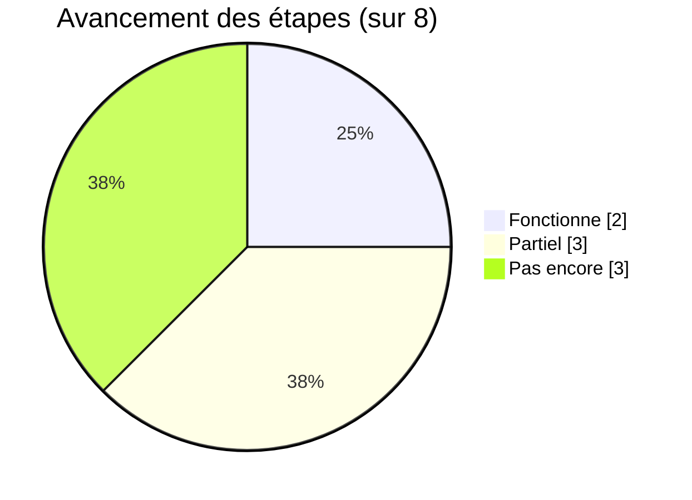
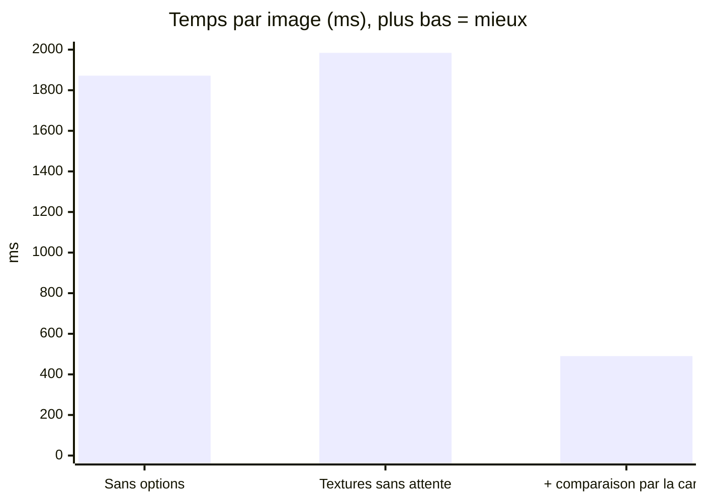
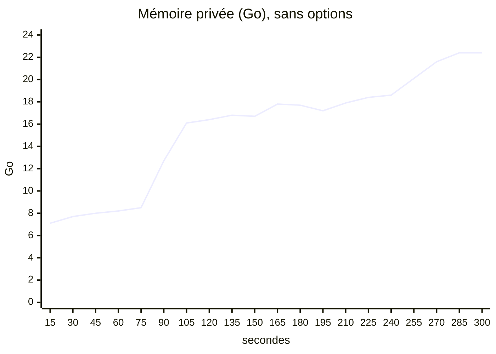
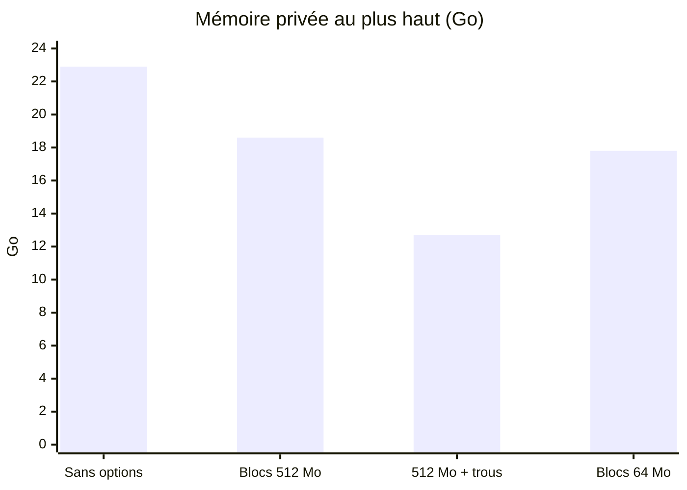
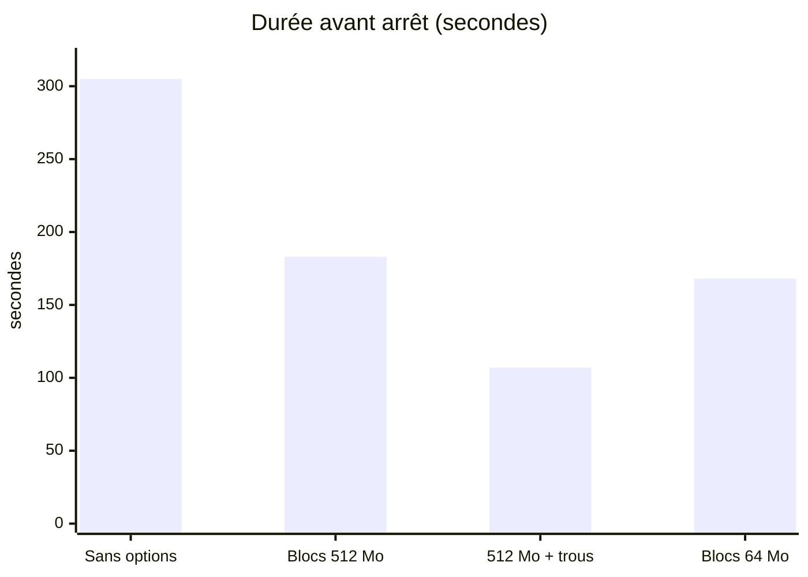
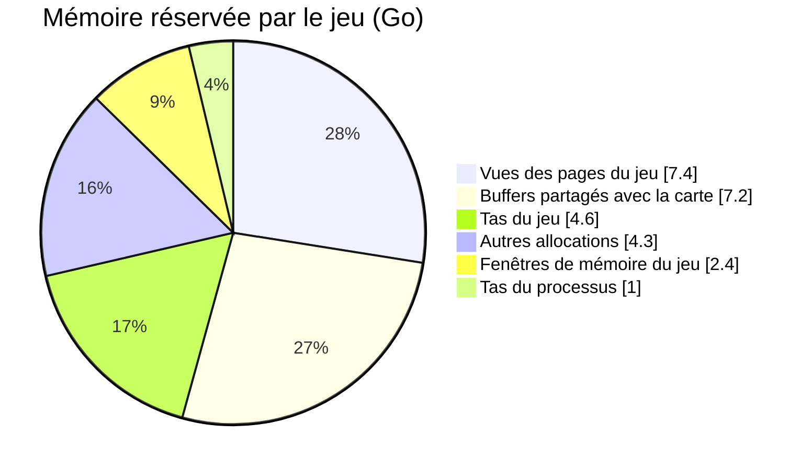
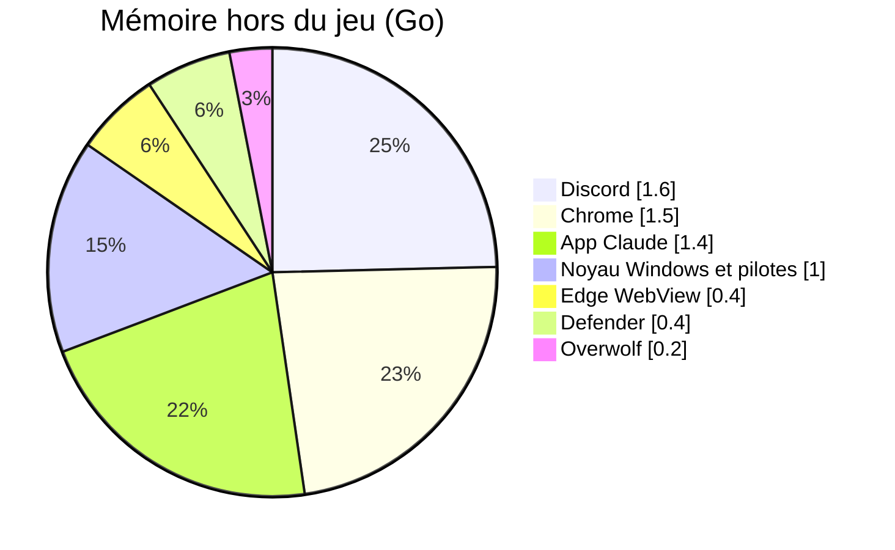
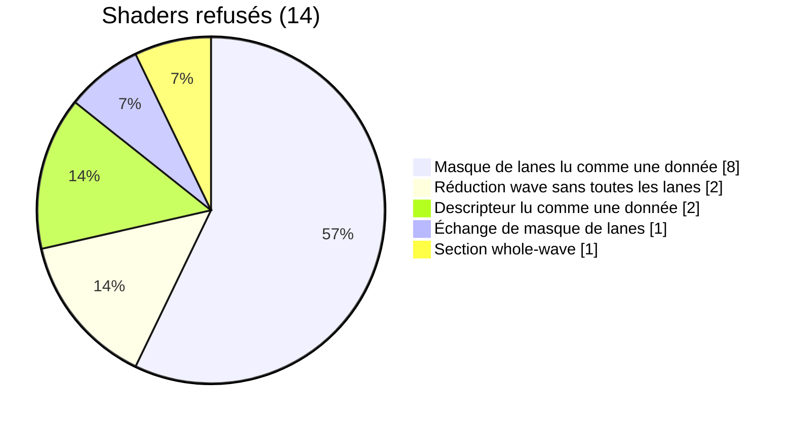

# VIctory : GTA VI (Xbox Series) sur PC, avancement

Version de travail de [VIctory](https://github.com/Marvisak/VIctory), qui fait
tourner la version Xbox Series de Grand Theft Auto VI directement sous Windows,
à partir des fichiers du jeu que l'utilisateur fournit. Elle part du fork
[fxceless/victory-gta6](https://github.com/fxceless/victory-gta6) (commit
`578d459`) et de ses commits suivants, jusqu'à `4e17478`, plus la « carte des
vues » de [Xeltax/VIcky](https://github.com/Xeltax/VIcky) (branche
`fx-heapmap`).

**Ce dépôt ne contient aucun fichier du jeu** : ni exécutable, ni données, ni
shaders extraits. Il faut sa propre copie du jeu. Ce projet n'est ni affilié à
Rockstar Games ou Take-Two Interactive, ni approuvé par eux.

Mis à jour le 24/11/2026.

## Crédits et licence

- **[VIctory](https://github.com/Marvisak/VIctory)**, par Marvisak et ses
  contributeurs, est la base de tout : le chargeur, les services du système,
  le rendu Direct3D 12 et le recompilateur de shaders. Licence
  GPL-3.0-or-later, comme ce dépôt (voir `LICENSE`).
- **[victory-gta6](https://github.com/fxceless/victory-gta6)**, par fxceless :
  le fork dont part ce travail (rendu du monde, ray tracing en cours).
- **[VIcky](https://github.com/Xeltax/VIcky)**, par Xeltax : la carte des vues
  pour la limite d'un million de vues des cartes NVIDIA.
- **[XCL](https://github.com/ivall/xcl)**, par ivall (GPL-2.0-only), a servi de
  référence pour le comportement du jeu sous une autre couche.
- Le texte d'origine, en anglais, est dans
  [docs/README-original.en.md](docs/README-original.en.md).
- Développé avec [Claude Code](https://claude.com/claude-code).

## Où en est le jeu

| Étape | État |
|-------|------|
| Démarrage, menus, écran titre | ✅ fonctionne |
| Cinématique d'intro | ⚠️ se joue en entier, mais le logo Rockstar est mal éclairé |
| Sauvegardes | ✅ le jeu sauvegarde et recharge un point de passage |
| Premier passage jouable (prologue) | ⚠️ s'affiche : personnages, textures, ciel, extérieur au soleil |
| Lumière dans l'ombre | ❌ le ray tracing du jeu ne tourne pas encore : tout ce que le soleil ne touche pas est noir |
| Images par seconde dans le monde | ❌ environ 2, pointes à 4 (avec les options de vitesse ci-dessous) |
| Mémoire | ❌ 18 à 23 Go après 3 à 5 minutes, trop pour un PC de 16 Go |
| Stabilité | ⚠️ sans options, 5 minutes sans plantage ; avec les options mémoire, plantage entre 2 et 3 minutes |



## Lancer

```powershell
cargo build --profile diag -p victory --features diagnostics
target\diag\victory.exe run "D:\chemin\vers\game_scarlett_master.exe" --execute
```

Le chemin du jeu peut aussi être mis dans `victory.toml` (modèle :
`victory.example.toml`).

**Options de vitesse recommandées** (pas encore par défaut) :

```powershell
$env:VICTORY_TEXTURE_NO_WAIT = '1'
$env:VICTORY_CARD_BUFFERS_MIN_MB = '1'
$env:VICTORY_CARD_BUFFERS_MB = '2048'
$env:VICTORY_SHADER_LOOP_LIMIT = '32'
```

Après une mise à jour du traducteur, le premier lancement recompile les
programmes graphiques : image noire ou cassée pendant plusieurs minutes. Le
lancement suivant les recharge. Ce qui reste à essayer en jeu est décrit dans
[docs/TESTS-A-FAIRE.md](docs/TESTS-A-FAIRE.md).

## Vitesse

Temps par image dans le monde, en millisecondes (meilleures images mesurées).



| Par image | Sans options | Textures sans attente | + comparaison par la carte |
|---|---|---|---|
| Textures | 865 à 3 800 ms | 12 à 62 ms | 5 à 47 ms |
| Recopie vers le jeu | environ 170 ms | 665 à 1 000 ms | 50 à 85 ms |
| Carte graphique | environ 250 ms | 580 à 820 ms | 230 à 380 ms |

Ce qui limite maintenant : la carte travaille 220 à 270 ms par image. Pour
30 images/s il faut descendre sous 33 ms.

## Mémoire

PC de test : Windows 11, carte NVIDIA, **16 Go de RAM**, fichier d'échange de
32 Go.

### Mémoire du jeu au fil du temps

Mémoire privée du processus, en Go, mesurée toutes les 15 secondes. Le saut
vers 1 min 30 correspond à l'arrivée dans le monde.



### Les lancements comparés





| Lancement | Mémoire au plus haut | Copies de la mémoire du jeu | Fin |
|-----------|----------------------|-----------------------------|-----|
| Sans options | 22,9 Go, en hausse | 4,2 Go | arrêté à 5 min, pas de plantage |
| `VICTORY_POOL_COMMIT=1` + `VICTORY_INPLACE=1`, blocs de 512 Mo | 18,6 Go | 4,5 Go | plantage à 183 s (RAM épuisée) |
| idem + fenêtres « à trous » | 12,7 Go | presque aucune à ce moment | plantage à 107 s (RAM épuisée) |
| idem, blocs de 64 Mo | 17,8 Go | 4,4 Go | plantage à 168 s (mémoire réservable de Windows épuisée) |

### Où va la mémoire du jeu (lancement sans options, à 5 min)

Mémoire réservée par type, en Go (toute n'est pas en RAM à la fois).



### La mémoire prise hors du jeu

Environ 7 Go sont déjà pris avant de lancer le jeu. Fermer Discord, Chrome et
Overwolf en libère environ 3,3 Go.



### Ce qu'on a appris

- Le pilote NVIDIA refuse d'ouvrir le pool du jeu (6,1 Go) en une seule
  section. Découpé en blocs (`VICTORY_POOL_BLOCK_MB`, 64 par défaut), chaque
  bloc s'ouvre.
- **Ouvrir une section côté carte graphique la verrouille entièrement en
  RAM**, même les pages jamais touchées. Les sections ouvertes comptent donc
  dans la limite `VICTORY_INPLACE_MB` (4096 par défaut).
- La plupart des fenêtres de 4 Mo refusées ne sont que **partiellement
  mappées** par le jeu (803 fenêtres, 3,4 Go). Très peu ont leurs pages dans le
  désordre (32, 140 Mo). Les fenêtres partielles dont les pages suivent une
  même section sont maintenant lues sans copie (`VICTORY_INPLACE_HOLES=0`
  revient à la copie).
- Pointer les tuiles d'un buffer réservé vers une section **fait perdre la
  carte NVIDIA**. Les pages dispersées ne peuvent donc pas être couvertes par
  cette voie. Test : `cargo test -p victory-gpu card_probe -- --ignored --nocapture`.
- Avec `VICTORY_POOL_COMMIT=1`, Windows réserve d'un coup 6,1 Go de plus : sur
  ce PC, le jeu plante plus tôt. **Pour l'instant, mieux vaut lancer sans les
  options mémoire.**

## Image

### Shaders encore refusés par le traducteur

Mesuré avant l'intégration des commits ray tracing du fork. Après : 10 refusés,
dont 2 traduits depuis (`v_cvt_f32_f64`, `v_permlanex16_b32`), et les
programmes wave64 sans boucle ont maintenant une forme en vagues de 32.



À cela s'ajoutaient **4 programmes de calcul refusés par le pilote NVIDIA**
(« Paramètre incorrect ») : ils demandaient des vagues de 64 lanes, que les
cartes NVIDIA n'ont pas. Le traducteur les refuse maintenant lui-même et leur
cherche encore une forme en 32 lanes. Ce sont des programmes du constructeur
de ray tracing : tant qu'il en manque un, le constructeur reste éteint.

### Ray tracing

Les commits `6a2d9f9` à `7b0f736` du fork sont intégrés : les programmes
d'ombre et de tracé se traduisent, et le test rayon/boîte et rayon/triangle du
matériel est émulé. La perte de la carte graphique de ces versions venait
d'une forme « wave64 » des shaders de particules, qui met des barrières de
groupe dans des branches et des boucles. Elle est maintenant active par défaut
pour les programmes **sans boucle** seulement (`VICTORY_WAVE_WIDE=1` : partout,
`0` : nulle part).
Le ray tracing reste désactivé par défaut (`VICTORY_BVH_BUILDER=1`). Détails :
[docs/fork-ray-tracing.md](docs/fork-ray-tracing.md).

## Ce qui reste à faire

1. Essayer en jeu ce qui vient d'être codé : [docs/TESTS-A-FAIRE.md](docs/TESTS-A-FAIRE.md)
   (carte des vues, forme wave64 sans boucle, lumière de secours
   `VICTORY_RT_MISS=1`, cheveux, ray tracing, logo, murs).
2. Traduire les shaders encore refusés (descripteurs lus comme des données,
   programmes wave64 avec boucles).
3. Faire tourner le ray tracing dans le jeu.
4. Réduire le travail de la carte graphique (vitesse).
5. Réduire la mémoire : fenêtres à trous qui ne suivent pas une seule section
   (2,6 Go encore copiés), textures côté PC (3 à 4,5 Go), buffers partagés
   avec la carte (environ 7 Go réservés).
6. Régler `VICTORY_PIPELINE_WAIT_MS` pour supprimer les trous à l'image, et
   vérifier que le cache des pipelines se remplit d'un lancement à l'autre.

## Options utiles

| Variable | Effet |
|----------|-------|
| `VICTORY_POOL_COMMIT=1` | réserve le pool du jeu d'un coup (nécessaire pour l'ouvrir sur la carte) |
| `VICTORY_POOL_BLOCK_MB` | taille des blocs du pool (64 par défaut) |
| `VICTORY_INPLACE=1` | lit la mémoire du jeu sans copie quand c'est possible |
| `VICTORY_INPLACE_MB` | mémoire verrouillée au plus pour cela (4096 par défaut) |
| `VICTORY_INPLACE_HOLES=0` | recopie les fenêtres partiellement mappées |
| `VICTORY_PIPELINE_WAIT_MS` | attente maximale des pipelines par image (500 par défaut) |
| `VICTORY_D3D12_DEBUG=1` | couche de débogage Direct3D (build `diag`), nomme les erreurs |
| `VICTORY_BVH_BUILDER=1` | active la construction des structures de ray tracing |
| `VICTORY_WAVE_WIDE` | forme wave64 « vague entière » : par défaut sans boucle seulement ; `1` partout, `0` nulle part |
| `VICTORY_WAVE_LOCAL=idiom` | seulement les formes exactes des programmes wave64 |
| `VICTORY_RT_MISS=1` | lumière de secours : les rayons ne touchent rien |
| `VICTORY_HEAP_MAP=0` | coupe la carte des vues de VIcky |
| `VICTORY_TEXTURE_NO_WAIT=1` | les textures n'attendent pas les remappages du jeu |
| `VICTORY_CARD_BUFFERS_MIN_MB=1` | la carte compare les buffers au lieu du processeur |
| `VICTORY_PROFILE=4` | profileur (build `diag`) |
