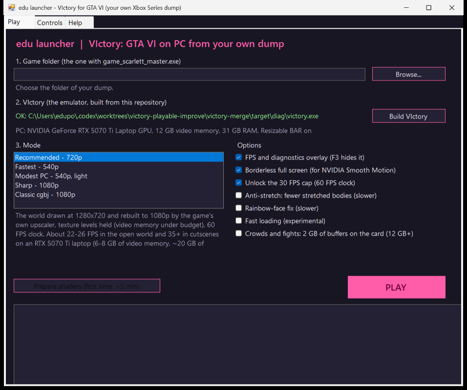

<div align="center">


<a href="#where-it-stands"></a>

<p>
  <a href="#quick-start-edu-launcher"></a>
  <a href="docs/GUIDE-30FPS.md"></a>
  <a href="docs/LUZ-24FPS.md"></a>
  <a href="https://github.com/edupode"></a>
</p>

<p>
  
  
  
  
  
  
  
</p>

<p>
  <a href="#quick-start-edu-launcher"></a>
  <a href="#modes"></a>
  <a href="#controls"></a>
  <a href="#where-it-stands"></a>
</p>

</div>

> [!NOTE]
> **This is a remake by [@edupode](https://github.com/edupode)** of the Cold Project VI idea, internally
> called **"luz"** (Portuguese for *light*, after the lighting work it started with). It combines
> [VIctory](https://github.com/Marvisak/VIctory), the cgbj build (cputroll/cgbj-reupload), Leonidas's and
> AnyXboxSeries's work, the VIctory-NVIDIA fork (trustno1-coder) and adaptations from an AMD fork
> (avatarmanz/VIctory-7900XTX), tuned and extended for an NVIDIA laptop. It is not the upstream Cold Project
> VI (felicienradio/cold-project-vi), whose page inspired this one.

> [!IMPORTANT]
> **This repository contains no game files**: no executable, data or extracted shaders. You need your own copy
> of the game. Not affiliated with or endorsed by the game's developer or publisher.

### From the author

> It runs 24-26 fps, all controls have been mapped,currently using -locallights  
> On the Open world i get about 22-24fps  
> Everything seems to be loading ok  
> I need help to fix volumetric shaders _Tiled (i already know how to fix them but it will take some time)  
> It's running on 12gb vram and 32gb ddr5  
> Currently it uses about 6-8gb on vram and 20-21gb of ddr5  
> it used to use 10-12gb on vram and 27-29gb of ram of ddr5  
> I got a laptop with a rtx 5070 ti capped at 145w and a Intel i9 ultra 275hx  
> Hope this helps anyone, missions are already possible and doesn't crash even after long sessions  
> on menus it goes from 30-32/33fps now its 60 fixed  

GTA VI from **your own Xbox Series dump**, on Windows with an NVIDIA RTX card, through
[VIctory](https://github.com/Marvisak/VIctory) (this branch: the cgbj build with the VIctory-NVIDIA
lighting and many changes of our own). **No game files are included.**

## Quick start: edu launcher

1. Install [Rust](https://rustup.rs) and the Visual Studio Build Tools (C++ workload + Windows SDK).
2. Clone this branch and build the launcher (no extra tools needed):
   ```powershell
   git clone -b edupode https://github.com/edupode/cold-project-vi.git
   cd cold-project-vi
   launcheruild-launcher.cmd
   ```
3. Open **`edu-launcher.exe`**:
   - **Build VIctory** (once, several minutes);
   - choose your **game folder** (the one with `game_scarlett_master.exe`);
   - **Prepare shaders** (about 5 minutes; again after each rebuild);
   - pick a **mode** and press **PLAY**.

If Windows says "Access denied", Defender's ransomware rule blocked the new exe. In an administrator
PowerShell: `Add-MpPreference -AttackSurfaceReductionOnlyExclusions "<repo folder>	arget"`.

<p align="center"></p>

The launcher checks your GPU, video memory, RAM and Resizable BAR and sets everything else. On cards with
less than 10 GB or PCs with less than 24 GB of RAM it picks the **Modest PC** mode (540p, textures over 1024
texels halved, fewer buffers on the card, the memory guards on).
`Jogar-Luz.cmd` does the same from a command line (`Jogar-Luz.cmd tudo`).

## Modes

| Mode | What it does | RTX 5070 Ti laptop |
|---|---|---|
| **Recommended - 720p** | World at 1280x720 + the game's own upscaler to 1080p, texture levels held, 60 FPS clock | open world 22-26 FPS, cutscenes 35+, menus 60 |
| Fastest - 540p | Softer picture, most frames; for slower CPUs | a few FPS more |
| Modest PC - 540p, light | For 6-8 GB cards and 16 GB of RAM: less video memory and RAM | |
| Sharp - 1080p | Full resolution | slower in the open world |
| Classic cgbj | The original cgbj settings | for comparison |

Options: FPS/diagnostics overlay (F3), borderless full screen (needed by NVIDIA Smooth Motion), the 60 FPS
clock, anti-stretch (fewer stretched bodies, slower), rainbow-face fix (slower), fast loading (experimental),
crowds and fights (2 GB of the game's buffers compared on the card; for 12 GB cards and up).

## Controls

Keyboard and mouse are mapped to the Xbox pad (a connected controller replaces them). Click the game window
to capture the mouse (Alt/F1 releases it). **F** enters vehicles and switches W/S to accelerate/brake (high
beep); in aircraft hold **W** (throttle) and **K** (nose up) to take off, **I** for nose down. Full table:
the launcher's Controls tab or [docs/GUIDE-30FPS.md](docs/GUIDE-30FPS.md).

## Before and after

| | Before (cgbj on this laptop) | Now (edu launcher, Recommended) |
|---|---|---|
| Menus and map | 30-33 FPS | **60 FPS** |
| Open world | 10-15 FPS | **22-26 FPS** |
| Cutscenes | ~26 FPS | **35-38 FPS** |
| Video memory | ~12 GB (over the system's budget) | **6-8 GB** |
| RAM | 27-29 GB | **20-21 GB** |

## FAQ

**The first cutscene lags a lot.** On the first run the game draws everything for the first time: thousands of
pipelines are made and the textures of the whole scene stream in. It runs at 7-15 FPS there, dropping to 2 now
and then, and then settles at 21-25. Press *Prepare shaders* in the launcher first; each session also prepares
the pipelines it used for the next one, so later runs start much faster.

**Is a controller supported?** Yes, an Xbox controller connected to the PC replaces the keyboard and mouse.

## Where it stands

- Works: intro, prison, missions, open world, boats; long sessions without crashes.
- Video memory under the system's budget (6-8 GB used on a 12 GB card), ~20 GB of RAM.
- The CPU is the limit: in fights with many people the frame drops to 10-15 FPS (8,000+ draws a frame,
  80-90 MB of the game's memory copied and 10 ms copied back each frame).
- Known problems: stretched bodies for a frame or two ("spaghetti"), rainbow faces now and then, black
  flickers on characters, the `_Tiled` water volumetrics shader off (black squares when on), no ray tracing.

More: [docs/GUIDE-30FPS.md](docs/GUIDE-30FPS.md) (English guide and what each setting does),
[docs/LUZ-24FPS.md](docs/LUZ-24FPS.md) (Portuguese notes), [docs/replay.md](docs/replay.md) (frame recorder).
Earlier upstream notes: [docs/archive/README-upstream.md](docs/archive-README-upstream.md).

---

Maintained by **@edupode** on GitHub: <https://github.com/edupode>
