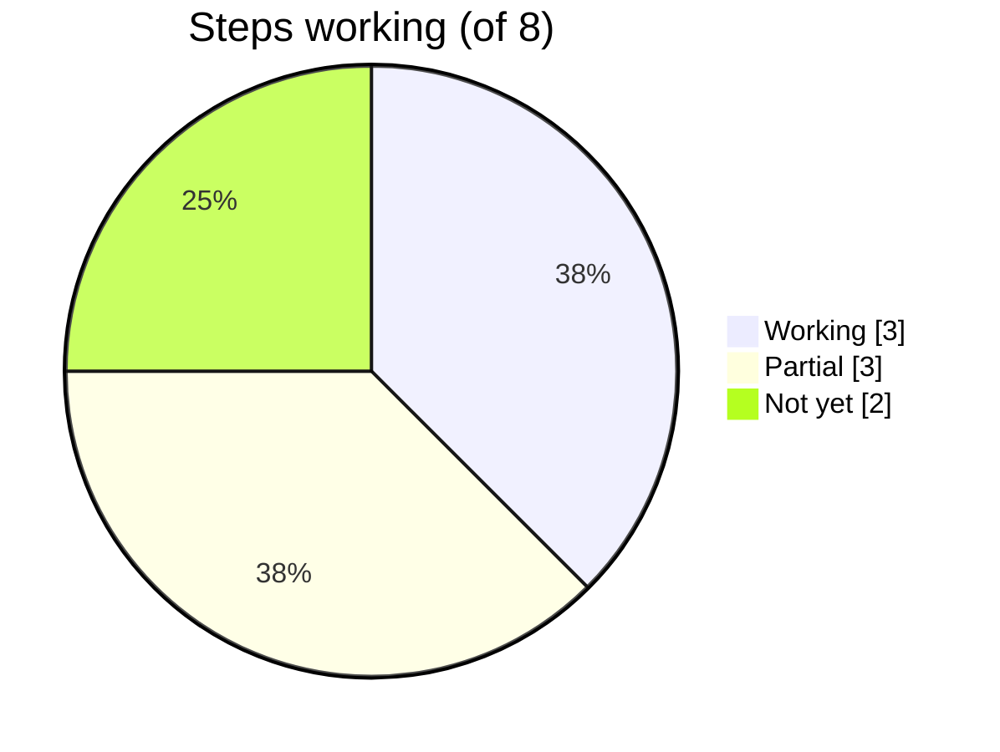
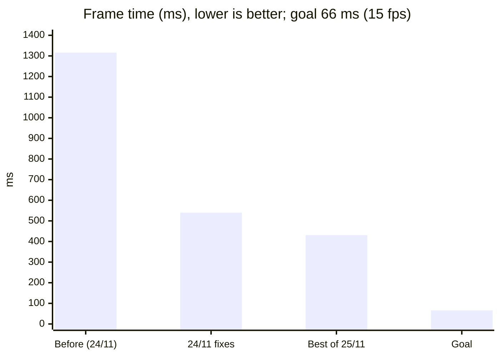
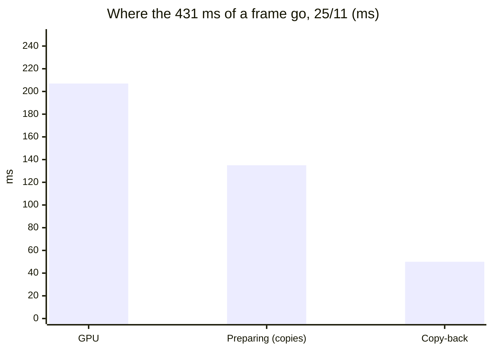
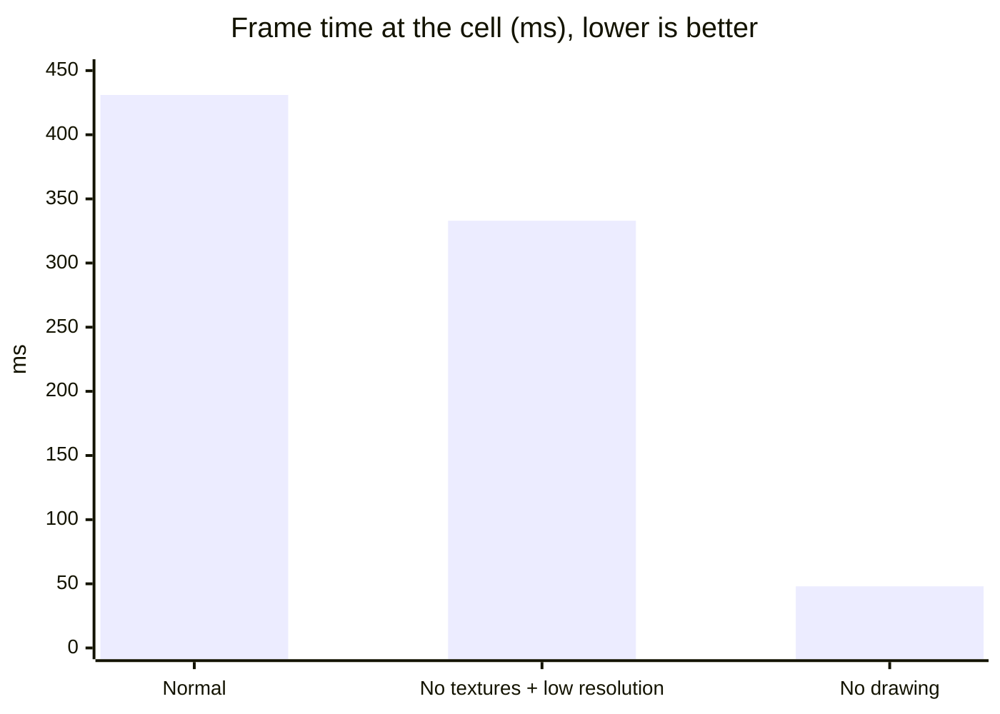
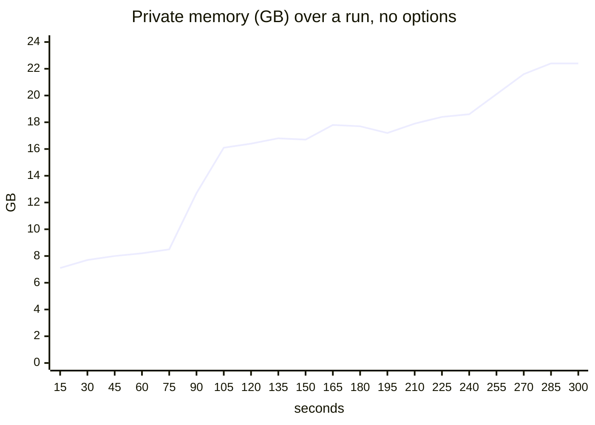
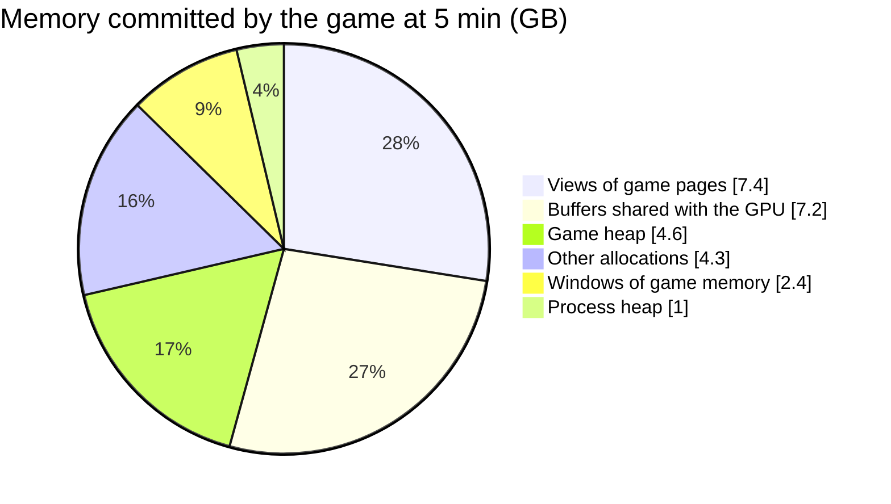
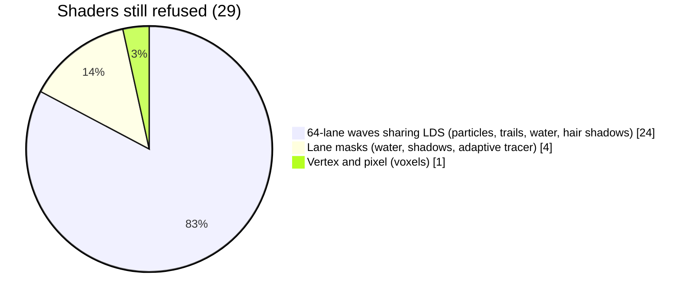

<div align="center">


<a href="#where-the-game-stands"></a>

<p>
  <a href="README.md"></a>
  <a href="README.fr.md"></a>
  <a href="https://discord.gg/GBJT5E8E4E"></a>
  <a href="../../releases/latest"></a>
</p>

<p>
  
  
  
  
  
  
</p>

<p>
  <a href="#run-it"></a>
  <a href="#the-launcher"></a>
  <a href="#speed"></a>
  <a href="#memory"></a>
  <a href="#picture"></a>
  <a href="#what-is-left"></a>
</p>

</div>

A working version of [VIctory](https://github.com/Marvisak/VIctory), which runs
the Xbox Series build of an open-world game natively on Windows, from game
files you supply yourself. It starts from fxceless's
[victory-fork](https://github.com/fxceless/victory-fork) (up to `4e17478`),
with the view map of [Xeltax/VIcky](https://github.com/Xeltax/VIcky) and work
from many other forks, named in each commit. *La même page en français :
[README.fr.md](README.fr.md).*

> [!IMPORTANT]
> **This repository contains no game files**: no executable, data or extracted
> shaders. You need your own copy of the game. Not affiliated with or endorsed
> by the game's developer or publisher.

> [!NOTE]
> **New on 25 November**: a [launcher](#the-launcher) with Discord presence and
> saves by place, two [test modes](#test-modes) (no textures, no drawing), and
> a measurement of [what the game costs on its own](#what-the-game-costs-alone-and-what-our-layer-costs).

## Where the game stands

### Progress: about 60 %

`████████████░░░░░░░░` **about 60 %: playable** (you control the heroine in the prologue)

Measured on [PortWatch VI](https://portwatch-vi.xyz/#method)'s scale: up to
50 %, each step needs the one before; beyond that, story, picture, speed and
stability share the last 50 points. Those are our estimate: PortWatch counts
them only with proof (a video).

| Milestone | % | State |
|---|---|---|
| Groundwork (loader, libraries, shaders, D3D12 rendering) | 0-10 | ✅ |
| The executable runs | 10 | ✅ |
| First picture (logos, intro) | 20 | ✅ |
| Main menu | 30 | ✅ |
| In the world (the prologue loads and shows) | 40 | ✅ |
| Playable (you control a character) | 50 | ✅ the heroine moves in the prologue |
| Story (17.5 points) | 0 | ⏳ still in the opening; finishing the prologue is worth about 3 |
| Picture (12.5 points) | about 6 | ⚠️ lit, but big effects are missing (shadows, ray tracing) |
| Speed (10 points: fps ÷ 30) | about 1.4 | ❌ 4.0-4.4 fps (10-minute run, 25/11 night); goal 15 |
| Stability (10 points) | about 2.5 | ⚠️ not measured over a long session yet |

| Step | State |
|---|---|
| Boot, menus, title screen | ✅ works, 30 fps |
| Intro cutscene | ✅ plays through and displays correctly |
| Saves | ✅ the game saves and reloads a checkpoint |
| Prologue | ✅ playable: characters, textures, sky, sunlit exterior |
| Light in the shade | ⚠️ fallback light by default: interiors and faces are lit, but some night cutscenes stay almost black (the game's ray tracing does not run yet) |
| Frame rate in the world | ❌ 4.0-4.4 fps (230-250 ms a frame: preparing 125, GPU 85-100, copy-back 55-70) on an RTX 3060 with 16 GB of RAM; 30 in the menus |
| Memory | ⚠️ about 22-25 GB committed on a 16 GB PC. The CPU side of the copies that live on the GPU is now ordinary memory Windows can page out (it was 3-4.5 GB locked for the GPU): at the end of a 10-minute run the game still has about 5 GB in RAM instead of under 1 GB |
| Stability | ⚠️ a full 10-minute run in the world without stopping (25/11 evening), where it used to stop silently about 9 minutes in. `VICTORY_HOLD=71B6330:1` pauses the game's hang watchdog and `VICTORY_PATCH=5AD8E60:E8DB605FFF:B800000100,5ABB240:E8FB3C61FF:B800000100` enlarges two object pools that ran empty (ideas from Tejvardhan-717); a page file of 32 GB or more still helps |



## Run it

**Easiest:** download the package from the
[latest release](../../releases/latest), unzip it, set your game folder in
`victory.toml` (`[paths] game_dir = '...'`, the folder that holds
`game_scarlett_master.exe`), run `Prechauffer.cmd` once (it translates every
shader into the cache, a few minutes), then `Lanceur.exe`. On the title
screen press A (Enter on the keyboard).

**From source:**

```powershell
cargo build --profile diag -p victory --features diagnostics
target\diag\victory.exe translate --cache
target\diag\victory.exe run "<game folder>\game_scarlett_master.exe" --execute --console series-s
```

**You need** Windows 10/11 x64 with AVX2, a D3D12 GPU with shader model 6.6
and mesh shaders (NVIDIA RTX 20 series or newer), 16 GB of RAM or more,
Microsoft's Visual C++ x64 redistributable and a **page file of at least
32 GB** (Advanced system settings → Performance → Virtual memory): the game
commits about 21 GB, and with the default page file Windows runs out and the
game closes without a report.

Recommended settings, all on by default: the **Series S** profile
(`--console series-s`, lighter settings), the **fallback light**
(`VICTORY_RT_MISS`, `0` turns it off), and the speed options that used to be
switches (`VICTORY_TEXTURE_NO_WAIT`, `VICTORY_CARD_BUFFERS_MIN_MB`,
`VICTORY_CARD_BUFFERS_MB`). Run `Prechauffer.cmd` again after every update of
the shader translator: without it the first run translates shaders on the fly
(a black or broken picture for minutes). What is left to try in game is in
[docs/TESTS-A-FAIRE.md](docs/TESTS-A-FAIRE.md) (French).

### The launcher

`Lanceur.exe` (source in `apps/lanceur`, Rust + egui, in French):

- **ready-made modes** and **manual settings**: Series S or X, internal
  resolution (0.2 to 1.0), the game's own temporal upscaler, textures,
  lighting, on-screen counter, AMD FSR (experimental), extra `VICTORY_…`
  variables;
- **live fps** while playing (ms a frame, draws, world or menus, play time,
  last log lines); the full log goes to `logs\partie-lanceur-<date>.txt`;
- **Discord presence**: "Playing" and the game's name, from the entry Discord
  already has in its public list of games (nothing to create), with where you
  are, the fps, the mode and the elapsed time;
- **saves by place**: keep the current state under a name (cell, cafeteria,
  boat...) and start from it next time (the saves before go to
  `_avant-restauration`).

It keeps its settings in `%LOCALAPPDATA%\victory\lanceur.toml`. Build it on
its own (it is outside the game's workspace):

```powershell
cd apps\lanceur
cargo build --release
```

then copy `target\release\lanceur.exe` to the repository root as
`Lanceur.exe`. It does not pick chapters (the game has none; saves by place
stand in) and cannot teleport or make you invincible (that would need the
player's position and health found in game memory, without symbols).

### Test modes

| Switch | Effect |
|---|---|
| `VICTORY_NO_TEXTURES=1` | the game's textures are neither sent to the GPU nor shown: every view reads a small grey texture of the same shape (2D, array, cube, 3D). Render targets, depth and what the GPU writes stay |
| `VICTORY_NO_DRAWS=1` | no pipelines, no shaders: every draw is dropped and the screen stays black (the counter shows). The game still runs, to measure the game on its own |

### Test your PC (`Tester.cmd`)

We have measured on one PC only (RTX 3060 12 GB, Ryzen 7 5700G, 16 GB:
4.5 fps steady, 5 at best). Reports from other PCs, above all with 32-64 GB
of RAM or a stronger card, tell us what is our layer's cost and what is the
PC's. Double-click `Tester.cmd` (run `Prechauffer.cmd` once before, after
every update): it starts the game, presses A on the title screen, measures
5 minutes in the world (`Tester.ps1 -Minutes 10` for longer, `-Console
series-x` for the other profile), takes a screenshot every 30 s, closes the
game and writes `rapports	est-<date>
apport.md` (your PC, fps, where a
frame goes, memory, errors) and a zip with the log and the screenshots.
Your Windows user name is taken out of both; nothing is sent anywhere.
Open a **Config test** issue, paste `rapport.md` and attach the zip.

## Speed

Frame time in the world (the cell scene, RTX 3060, 16 GB, Series S profile):





### What the game costs alone, and what our layer costs

Three runs at the cell with the test modes:

| Per frame | Normal | No textures, low resolution | No drawing (`VICTORY_NO_DRAWS`) |
|---|---|---|---|
| fps | 2.3 | **3.0** (steady) | **19 to 24** |
| Frame time | 431 ms | 333 ms | 42 to 53 ms |
| Preparing (our copies) | 135 ms | 130 ms (85 ms for 180 MB copied) | 0.4 ms |
| GPU | 207 ms | 112 ms | 0 |
| Copy-back into game memory | 50 ms | 34 ms | 0.1 ms |
| Game RAM (committed) | 21 GB | 14.4 GB | **6 GB** |
| GPU memory | 8 GB | 4 GB | — |



What this says:

1. **This PC tops out around 20 fps**: with nothing drawn, the game's own
   code (world, characters, streaming, sound) and our system services take
   42 to 53 ms a frame, and that time varies with what the game loads.
2. **The 15 GB that overflow the RAM are our graphics layer's**, not the
   game's (6 GB without drawing, 21 GB with).
3. **Hypothesis**: textures and resolution are no longer the problem
   (without them the GPU only goes from 207 to 112 ms). What is left does not
   depend on pixels: our copies of about **180 MB of game memory to the GPU
   every frame** (vertices, constants, instances the game changes; 130 ms,
   the biggest wall, unmoved by any setting), our work around each indirect
   draw (about 2,000 clamp passes, each with a pipeline drain, plus our
   compares: about 110 ms at any resolution), and a full RAM (1 GB free).
   The next real gain is to **keep the game's data on the GPU instead of
   copying it every frame**.

### What helped and what did not (25 November)

| Change | Result | Kept? |
|---|---|---|
| Windows of game memory written by the CPU straight into the GPU's memory (Resizable BAR, `VICTORY_REBAR=1`, now the default where the GPU has it) | 4.06 → 4.19 fps on average; memory shared with the GPU 6.1 → 3.9 GB, 2.1 GB of RAM left free instead of under 0.6 | ✅ default (25/11 night) |
| Those fetches on a copy queue of their own, not behind everything queued since (`VICTORY_FETCH_QUEUE`) | fetch waits 75 → 7 ms a frame; **3.6-3.7 → 4.0-4.4 fps** | ✅ default (25/11 night) |
| Changed pieces of GPU-side copies fetched by a copy, not written by our compare shader into PC memory (`VICTORY_CARD_INLINE_FETCH` now off) | compare passes 340-520 → 2.6 ms (timing run); in the world 450 → 270 ms a frame, **2.2 → 3.6-3.7 fps**, and the cell's walls and light draw | ✅ default (25/11 night) |
| CPU side of GPU-side copies in ordinary, pageable memory (`VICTORY_CARD_PAGEABLE`) | a full 10-minute run instead of a silent stop about 9 minutes in | ✅ default |
| In-place copies (`crate::plaincopy`, from fxceless `a253706`) | copies 140 → 105 ms | ✅ default |
| Windows on a 1 MiB grid, with tails | 22.1 → 21.4 GB committed | ✅ default |
| Copy-back through `plaincopy` | 50 → 48 ms | ✅ |
| On-picture counter (`VICTORY_HUD=0` hides it), `Lancer.cmd` menu | — | ✅ |
| Grouped indirect clamps (`VICTORY_HOIST_CLAMPS=1`, Belobug's idea) | GPU 207 → 239 ms, a window's fence vanished | ❌ |
| Textures at 60 % of the GPU | 14,600 textures waiting, clothes in blocks | ❌ |
| Windows and buffers on the GPU (90 %, 4 GB) | GPU +64 ms | ❌ |
| Half resolution + simplified lighting | GPU −80 ms but 2.3 to 2.6 fps and blocks | ❌ |
| In-place reads (`VICTORY_INPLACE`) | GPU lost after 30 s (NVIDIA locks the whole section in RAM); at 1 GB: 2.19 fps | ❌ on 16 GB |
| Shaders note missing pages in a branch of their own | GPU 207 → 260 ms, 1.9 fps | ❌ reverted |
| Clamps done by the CPU | at most 35 % of the 2,000 qualify (the rest read arguments a shader just wrote): about 25 ms at best | not done |
| Card-memory copies off (`VICTORY_CARD_BUFFERS=0`) | GPU 30 to 130 ms (half our 207 ms is our own compare work), but preparing 490 ms and copy-back 190 ms: worse | ❌ |
| ScarlettPort's runtime as-is, with its settings | black intro, 0.4 to 0.8 fps, thousands of draws dropped for want of pipelines | ❌ |
| Upstream's page-marked copy-back (`cd94d35`) | about 100 conflicts on this branch: to be redone by hand | open |

**Where the GPU's time goes** (`VICTORY_GPU_TIMING=1`): no game program
dominates, the most expensive takes 6 ms a frame. Of the 122 ms noted command
by command, **80 ms go to the 4,100 indirect draws** (about 20 µs each: the
clamp passes and barriers around them more than the work), 34 ms to compute
dispatches, the rest to mesh draws, copies and texture uploads. The GPU counts
about 200 ms a frame in all: NVIDIA's timestamps do not see the drains between
passes.

### Other forks

| Fork | GPU | fps | Of use here |
|---|---|---|---|
| This one (25/11) | RTX 3060, 16 GB | **4.2** (measured) | — |
| [ScarlettPort](https://github.com/ZigZagBoi1/ScarlettPort) | RTX 3060, 32 GB advised | about 4 | copy-back for read-back buffers only, read waits 156 → 26 ms; tried here: under 1 fps |
| [VItoriaBr](https://github.com/uiliannn/VItoriaBr) | RTX 5060 Ti, 40 GB | 3.5 to 6 | their GPU takes 50 to 65 ms a frame |
| [DexNom/VIctory](https://github.com/DexNom/VIctory) | RX 7900 XTX | 1.03 | ray tracing that really runs (Radeon); precise tracking of shader writes |
| [VIctory](https://github.com/Marvisak/VIctory) (`cd94d35`) | — | — | copy-back compares only the pages shaders wrote |
| [ztrx](https://github.com/Zettrox/ztrx) | RTX 3050 | 1 to 3 | fxceless's code up to `4e17478` (already here); prologue to the boat chase, 1 h 30 without a crash |

## Memory

Test PC: Windows 11, NVIDIA GPU, **16 GB of RAM**, 32 GB page file.



The jump near 1 min 30 is the arrival in the world.



About 7 GB are taken before the game starts; closing Discord, Chrome and
Overwolf frees about 3.3 GB.

What we learned:

- NVIDIA's driver refuses to open the game's 6.1 GB pool as one section; split
  in blocks (`VICTORY_POOL_BLOCK_MB`, 64 by default) each block opens.
- **Opening a section on the GPU locks all of it in RAM**, even pages never
  touched, so open sections count against `VICTORY_INPLACE_MB` (4096 by
  default).
- Most refused 4 MB windows are only **partly mapped** by the game (803
  windows, 3.4 GB); very few have their pages out of order (32, 140 MB).
  Partial windows whose pages follow one section are now read without a copy
  (`VICTORY_INPLACE_HOLES=0` goes back to copying).
- Pointing a reserved buffer's tiles at a section **loses the NVIDIA GPU**.
- With `VICTORY_POOL_COMMIT=1` Windows commits 6.1 GB more at once: on this
  PC the game crashes sooner. **For now, run without the memory options.**

| Run | Peak memory | Copies of game memory | End |
|---|---|---|---|
| No options | 22.9 GB, rising | 4.2 GB | stopped at 5 min, no crash |
| `VICTORY_POOL_COMMIT=1` + `VICTORY_INPLACE=1`, 512 MB blocks | 18.6 GB | 4.5 GB | crash at 183 s (RAM exhausted) |
| same + windows with holes | 12.7 GB | almost none then | crash at 107 s (RAM exhausted) |
| same, 64 MB blocks | 17.8 GB | 4.4 GB | crash at 168 s (Windows commit exhausted) |

## Picture

### Shaders

The game holds 26,084 shaders; a scene uses about 2,000. Offline translation
of the whole archive, with 32-lane waves as on an RTX 3060:

| Kind | Translated | Total | % |
|---|---|---|---|
| Vertex and pixel | 14,246 | 14,247 | 99.99 % |
| Compute | 2,654 | 2,682 | 98.95 % |
| Mesh | 8,765 | 8,765 | 100 % |
| **All** | **25,665** | **25,694** | **99.89 %** |



Plus 195 geometry shaders (voxels, 0.7 % of the game) whose resources are not
tracked yet: counting them, 98.4 % of the 26,084 shaders translate. The 24
"64-lane waves" share group memory between several waves: step 8 of
[docs/wave64-on-wave32.md](docs/wave64-on-wave32.md), still open.

### Upscaling (FSR)

As a Series S the game renders 1280×720 and asks **FSR 4** for 1920×1080. FSR 4
cannot run here (its passes need an Xbox driver method we do not have, and its
fallback programs are shader model 5), so a **plain stretch** stands in
(`victory-gpu/src/upscale.rs`), with no sharpening and no accumulation: the
picture is softer than on the console.

Experimental: upstream's module (VIctory `0b35b7f`,
`victory-hle/src/modules/fidelityfx.rs`) serves the game's calls with **AMD's
PC FSR** (3.1.6 on an RTX). It needs the official
`amd_fidelityfx_upscaler_dx12.dll` from the
[FidelityFX SDK](https://github.com/GPUOpen-LibrariesAndSDKs/FidelityFX-SDK) in
a folder named by `VICTORY_FIDELITYFX_DIR`; without it, the plain stretch runs.
The game describes its images with console formats (an R9G9B9E5 output a PC
cannot write: a flat green, blue or red picture in the first test), so the
formats given are those of our copies and depth goes as an R32 copy. The
second test lost the GPU: **do not use it to play**. FSR would only bring
sharpness (1 to 2 ms of GPU), not frames. Not done yet: NVIDIA **DLSS**, for
which the game already provides everything (colour, depth, motion vectors,
jitter).

### Ray tracing

The game's indirect light and the shadows of its lamps and sun are ray traced,
in its own compute shaders (no ray-tracing API): the builder programs
(49 of 52), the trace programs (59 of 64) and the shading program translate,
and the hardware ray/box and ray/triangle test is emulated and checked bit for
bit on the GPU over 311 cases. The builder is **off by default**
(`VICTORY_BVH_BUILDER=1` turns it on) and has not run end to end in the game.
Meanwhile a **fallback light** is on: the ray test answers "nothing hit",
which lights shaded areas without ray-traced shadows (`VICTORY_RT_MISS=0`
turns it off). Details: [docs/fork-ray-tracing.md](docs/fork-ray-tracing.md).

## What is left

Measured on 25-26/11 (RTX 3060, 16 GB): about 4.1-4.2 fps, 230-250 ms a frame.

1. Speed (goal: 10 fps steady, so about 100 ms a frame). What is left:
   - GPU, 85-100 ms: mostly the fixed cost of about 4,400 small draws a
     frame (the costliest program, the cascade shadow mesh, is short; its
     23 ms come from 389 draws). The game changes pipeline between almost
     every draw, so they cannot simply be merged. Faster 64-lane programs on
     32-lane GPUs would help.
   - Preparing, about 125 ms: 70 ms of copies (about 190 MB a frame of game
     memory), the rest sending changed bytes up to GPU-side copies.
   - Copy-back, about 55 ms; and the render thread waits about a quarter of
     its time for it, because the game reads back memory the GPU just wrote
     (letting those reads through brought the device down: they are real).
   Tried and dropped: sending submissions ahead (`VICTORY_RELAY=2`),
   clamp windows ahead, hoisted clamps, a word-wise merge, window copies off
   the GPU.
2. Picture: the ray-tracing structure builder gives a wrong picture on
   NVIDIA (`VICTORY_BVH_BUILDER=1`: glowing hair, blown-out windows, 2.3
   fps), so rays miss by default and interiors stay dark. Four programs are
   still refused on 32-lane GPUs: alpha-tested cascade shadows (groups of two
   64-lane waves with wave-wide operations), the alpha transmission
   prefilter and two VFX triangle programs.
3. Stability: a full 10-minute run without stopping; longer sessions still
   to be measured.
4. Memory: 21 GB committed on 16 GB, with 2 GB of RAM left free.

## Useful switches

| Variable | Effect |
|---|---|
| `VICTORY_NO_TEXTURES=1` | grey surfaces, no game textures (test) |
| `VICTORY_NO_DRAWS=1` | nothing drawn, no pipelines or shaders (test) |
| `VICTORY_RENDER_SCALE` | fixed internal resolution, 0.2 to 1.0 of the output |
| `VICTORY_OWN_UPSCALER=1` | the game's own temporal upscaler instead of FSR |
| `VICTORY_FIDELITYFX_DIR` | folder of AMD's PC FSR DLL (experimental) |
| `VICTORY_HUD=0` | hides the on-picture counter |
| `VICTORY_RT_MISS=0` | turns the fallback light off |
| `VICTORY_BVH_BUILDER=1` | builds the ray-tracing structures |
| `VICTORY_GPU_TIMING=1` | time of every GPU command, by program (diagnostics build, slower) |
| `VICTORY_D3D12_DEBUG=1` | Direct3D debug layer, names errors (diagnostics build) |
| `VICTORY_SKIP_PIPELINES=<hash>,...` | skips the draws of the listed programs (to compare) |
| `VICTORY_PIPELINE_WAIT_MS` | longest wait for pipelines in a frame (500 by default) |
| `VICTORY_POOL_COMMIT=1`, `VICTORY_INPLACE=1` | read game memory without a copy where possible (crashes sooner on 16 GB) |
| `VICTORY_RELAY=2`, `VICTORY_LATE_WAIT=3` | submit without waiting for the GPU: slower on a 16 GB PC |
| `VICTORY_MISSING_LOG=1` | `translate`: says which instruction has no value and why |
| `VICTORY_PROFILE=4` | profiler (diagnostics build) |

## Community

Questions, results on your PC, bugs: the **[Discord server](https://discord.gg/GBJT5E8E4E)**.
For a bug, attach `logs\partie-lanceur-<date>.txt` and, if there is one,
`%LOCALAPPDATA%\victory\data\7952987A\crashes.log`.

## Credits and license

- **[VIctory](https://github.com/Marvisak/VIctory)**, by Marvisak and its
  contributors, is the base of everything: the loader, the system services,
  the Direct3D 12 renderer and the shader recompiler. GPL-3.0-or-later, like
  this repository (see `LICENSE`).
- **[victory-fork](https://github.com/fxceless/victory-fork)**, by fxceless:
  the fork this work starts from (world rendering, ray tracing in progress).
- **[VIcky](https://github.com/Xeltax/VIcky)**, by Xeltax: the view map for
  NVIDIA's one-million-view limit.
- **[XCL](https://github.com/ivall/xcl)**, by ivall (GPL-2.0-only), served as
  a reference for the game's behaviour under another layer.
- The work of many other forks (ScarlettPort, VItoriaBr, victory-perf,
  Belobug and more), named in each commit that takes it.
- The project's original text is in
  [docs/README-original.en.md](docs/README-original.en.md).
- Developed with [Claude Code](https://claude.com/claude-code).
