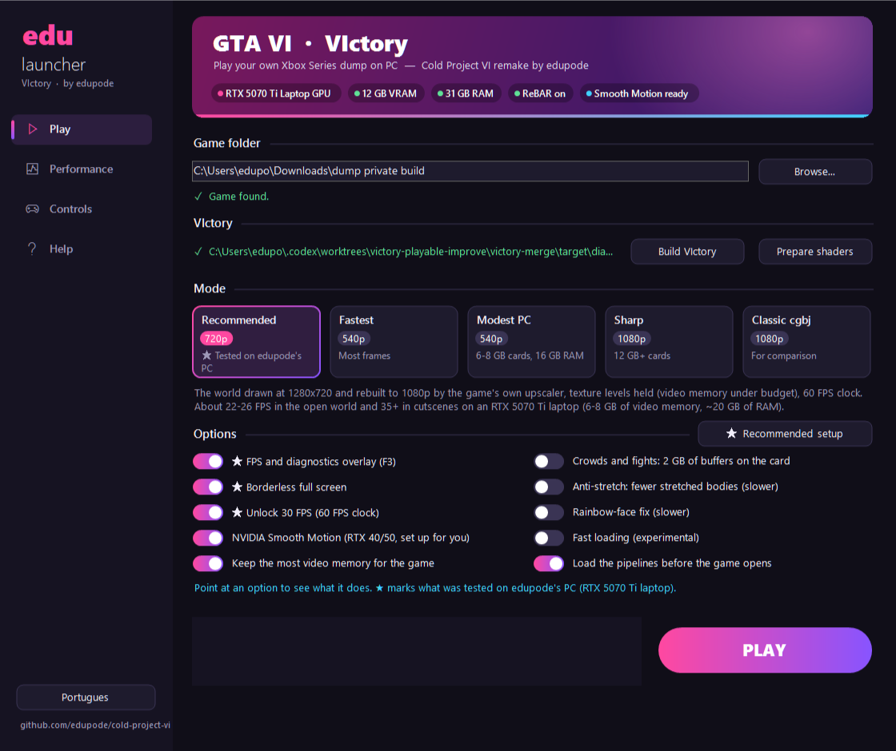

<div align="center">


<p>
  <a href="#come%C3%A7ar-edu-launcher"></a>
  <a href="README.md"></a>
  <a href="docs/LUZ-24FPS.md"></a>
  <a href="https://github.com/edupode"></a>
</p>

<p>
  
  
  
  
  
</p>

</div>

> [!NOTE]
> **Isto é um remake de [@edupode](https://github.com/edupode)** da ideia do Cold Project VI, com o nome interno
> **"luz"**. Junta o [VIctory](https://github.com/Marvisak/VIctory), a build do cgbj (cputroll/cgbj-reupload), o
> trabalho do Leonidas e do AnyXboxSeries, o fork VIctory-NVIDIA (trustno1-coder) e adaptações de um fork AMD
> (avatarmanz/VIctory-7900XTX), afinados e alargados para um portátil NVIDIA. Não é o Cold Project VI original
> (felicienradio/cold-project-vi), cuja página inspirou esta.

> [!IMPORTANT]
> **Este repositório não tem ficheiros do jogo**: nem executável, nem dados, nem shaders extraídos. Precisas da
> tua própria cópia do jogo. Sem ligação nem apoio do estúdio ou da editora do jogo.

GTA VI a partir do **teu próprio dump de Xbox Series**, no Windows com uma placa NVIDIA RTX, através do
[VIctory](https://github.com/Marvisak/VIctory). Este ramo é a build do cgbj com a iluminação do VIctory-NVIDIA
e muitas mudanças nossas. **Não inclui ficheiros do jogo.**

## Começar: edu launcher

1. Instala o [Rust](https://rustup.rs) e o Visual Studio Build Tools (C++ e um Windows SDK).
2. Clona este ramo e compila o launcher (não precisa de mais nada):
   ```powershell
   git clone -b edupode https://github.com/edupode/cold-project-vi.git
   cd cold-project-vi
   launcher\build-launcher.cmd
   ```
3. Abre o **`edu-launcher.exe`** e carrega em **Português** na barra lateral. Depois:
   - **Compilar VIctory** (uma vez, alguns minutos);
   - escolhe a **pasta do jogo** (a que tem o `game_scarlett_master.exe`);
   - **Preparar shaders** (cerca de 5 minutos; de novo depois de cada compilação);
   - carrega em **★ Configuração recomendada** e em **JOGAR**.

Se o Windows disser "Acesso negado", a regra anti-ransomware do Defender bloqueou o exe novo. Numa PowerShell de
administrador: `Add-MpPreference -AttackSurfaceReductionOnlyExclusions "<pasta do repositório>\target"`.

<p align="center"></p>

O launcher vê a tua placa, a VRAM, a RAM, o Resizable BAR e o suporte do Smooth Motion, e configura o resto.
Passa o rato por uma opção para ver o que faz; **★** marca o que foi testado no PC do autor. Em placas com menos de
10 GB ou PCs com menos de 24 GB de RAM escolhe o modo **PC modesto**.

### O que o launcher faz por ti

| | |
|---|---|
| **Barra de carregamento antes do jogo** | Antes de o jogo abrir (antes do primeiro menu), prepara em processos à parte todas as pipelines usadas nas sessões anteriores, para o driver já as ter: sem engasgos a primeira vez que vês um sítio. Demora segundos com a cache pronta. |
| **NVIDIA Smooth Motion** | Escrito no perfil do próprio driver para o `victory.exe` (como o NVIDIA Profile Inspector faz): **não precisa da NVIDIA App**. RTX 40/50, driver 571.86 ou mais recente. A placa mostra um frame gerado entre dois do jogo. |
| **Página Desempenho** | Mostra as apps que ocupam a VRAM e a RAM (NVIDIA Overlay, Discord, Wallpaper Engine, browsers...) e fecha as que marcares. O Windows só dá ao jogo o que as outras apps deixam livre. |
| **Reserva de VRAM** | O VIctory pede ao Windows uma reserva de VRAM: quando falta memória, as outras apps saem primeiro. |
| **Overlay de FPS (F3)** | FPS agora, média do último minuto (AVG 1M), média desde o início (ALL) e o pior meio segundo (LOW), tempo por frame, draws, VRAM e RAM. |

## Modos

| Modo | O que faz | Portátil RTX 5070 Ti |
|---|---|---|
| **★ Recomendado - 720p** | Mundo a 1280x720 + o upscaler do jogo para 1080p, níveis de texturas guardados, relógio de 60 FPS, sem bordas | mundo aberto 22-26 FPS, multidões 14-17, cutscenes 35+, menus 60 |
| Mais rápido - 540p | Imagem mais suave, mais frames; para processadores mais lentos | uns FPS a mais |
| PC modesto - 540p, leve | Para placas de 6-8 GB e 16 GB de RAM: menos VRAM e RAM | |
| Nítido - 1080p | Resolução completa | mais lento no mundo aberto |
| cgbj clássico | As definições originais do cgbj | para comparar |

## Controlos

Teclado e rato estão mapeados para o comando de Xbox (um comando ligado substitui-os). Clica na janela do jogo para
capturar o rato (Alt/F1 solta). **F** entra nos veículos e troca W/S para acelerar/travar (apito agudo); nos aviões
mantém **W** (acelerador) e **K** (nariz para cima) para levantar voo, **I** para baixar o nariz. Tabela completa:
página Controlos do launcher ou [docs/LUZ-24FPS.md](docs/LUZ-24FPS.md).

## Antes e depois

| | Antes (cgbj neste portátil) | Agora (edu launcher, Recomendado) |
|---|---|---|
| Menus e mapa | 30-33 FPS | **60 FPS** |
| Mundo aberto | 10-15 FPS | **22-26 FPS** |
| Multidões e lutas | 10-15 FPS | **14-17 FPS** |
| Cutscenes | ~26 FPS | **35-38 FPS** |
| VRAM | ~12 GB (acima do limite do sistema) | **6-8 GB** |
| RAM | 27-29 GB | **20-21 GB** |

## Perguntas

**A primeira cutscene engasga muito.** Na primeira vez o jogo desenha tudo pela primeira vez. Com a opção
"Carregar as pipelines antes de o jogo abrir", o launcher prepara antes o que as sessões anteriores usaram.

**Dá para gerar mais frames, como o DLSS Frame Generation?** O DLSS FG precisa dos vetores de movimento e da
profundidade do jogo e de uma imagem sem HUD, e o VIctory ainda não os distingue entre os buffers do jogo. O
**Smooth Motion** da NVIDIA faz o mesmo a partir da imagem final (2x), e o launcher liga-o por ti. Ferramentas como
o Lossless Scaling fazem 3x-4x de qualquer janela, mas a partir de ~22 FPS isso junta atraso e artefactos visíveis.

**Porque é que aparecem objetos pretos ou lisos mesmo num PC forte?** Por duas razões:
- texturas que ainda não chegaram à placa: o processador copia a memória do jogo para a placa, e a VRAM esgota-se.
  A página Desempenho e a reserva de VRAM ajudam;
- o shader de volumetria `_Tiled`, que ainda está a ser corrigido.

## Onde está

- Funciona: intro, prisão, missões, mundo aberto, barcos; sessões longas sem crashes.
- VRAM dentro do limite do sistema (6-8 GB numa placa de 12 GB), ~20 GB de RAM.
- O limite é o processador: multidões e lutas a 14-17 FPS (eram 10-15).
- Novo: as cópias de texturas cuja memória o jogo já libertou saem logo da placa (estava ~1 GB preso nelas), e o
  VIctory reserva a sua VRAM junto do Windows.
- `_Tiled` (volumetria da água): desligado por agora (quadrados pretos quando ligado). F9 no modo de gravação grava um
  frame. Esse frame pode correr no WARP (`VICTORY_REPLAY_WARP=1`) como onda de 64 e como duas de 32, para encontrar a
  instrução onde as duas formas divergem.
- Problemas conhecidos: corpos esticados durante um frame ou dois ("esparguete"), caras arco-íris de vez em quando,
  piscar preto nas personagens, sem ray tracing.

Mais: [docs/LUZ-24FPS.md](docs/LUZ-24FPS.md) (notas em português), [docs/GUIDE-30FPS.md](docs/GUIDE-30FPS.md) (guia em
inglês), [docs/replay.md](docs/replay.md) (gravador de frames).

---

Mantido por **@edupode** no GitHub: <https://github.com/edupode>
